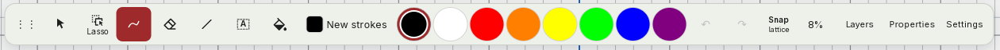
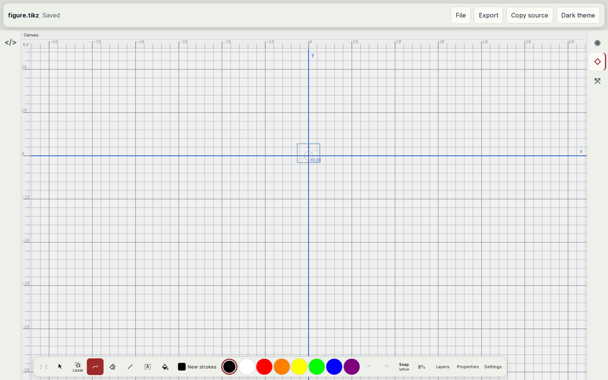

# Drawing dock

Audit of the canvas drawing dock against established pen-notebook and vector-editor conventions ([#19](https://github.com/dzackgarza/visual-tikz-editor/issues/19), part of [#17](https://github.com/dzackgarza/visual-tikz-editor/issues/17)). The specification at the end replaces every earlier rule about the dock. Where [the interaction model](../interaction-model.md) disagrees, this document holds; [#25](https://github.com/dzackgarza/visual-tikz-editor/issues/25) rewrites the model and its stories.

## The dock today

Source: fork `packages/app/src/ui/Toolbar.tsx:699-761`. The controls, in their fixed order: grip, Select, Lasso, Freehand, Eraser, Geometry, Label, Bucket, colour button with a target word, eight swatches, Undo, Redo, Snap, Zoom, Layers, Properties, Settings. During a construction a step lane adds the step text, Finish, and Cancel.

## Prior art

### Captured on this host

| Application | Screenshot | What the dock audit takes from it |
| --- | --- | --- |
| Xournal++ 1.3.8 (default profile) | [window](images/xournalpp-1.3.8.png), [toolbars](images/xournalpp-1.3.8-toolbar.png) | Tools are icons. A tool with options has a dropdown arrow next to it. Colour swatches sit in the tool toolbar. Grid and rotation snapping are icon toggles. Layer and zoom are in the footer, not in the tool toolbar. |
| Ipe 7.2.30 (default profile) | [window](images/ipe-7.2.30.png) | Tools are icons. Snapping is a group of icon toggles in the top toolbar. Stroke and fill colours are two colour wells in the Properties panel. Layers is a separate panel. |
| Inkscape 1.4.4 (default profile) | [window](images/inkscape-1.4.4.png) | Tools are icons in a vertical toolbox. Snapping is one icon button at the top right that turns snapping on and off, with an arrow beside it that opens the snapping popover ([1.2 release notes](https://wiki.inkscape.org/wiki/Release_notes/1.2)). Zoom and the current layer are in the status bar. Fill and Stroke is a docked dialog. The capture shows 1.0 % zoom because the window was resized after start; zoom is out of scope here. |

The iPad applications cannot be captured on this host. Their vendor help pages, linked below, carry the vendor's own screenshots.

### Documented behaviour

| Question | Convention | Sources |
| --- | --- | --- |
| What the drawing toolbar holds | Drawing tools, colour choices, and at most an Add and a More button. Panels such as Layers open elsewhere; Procreate is the one exception found. | Apple Markup: "Pen, Mono line, Marker, Eraser, Lasso, Ruler, and Pencil, followed by color buttons, the Add button, and the More button" ([Apple](https://support.apple.com/guide/ipad/draw-and-handwrite-with-markup-ipad6350b8dc/ipados)); GoodNotes, Noteful, Concepts, Xournal++, Ipe, Inkscape (survey on [#17](https://github.com/dzackgarza/visual-tikz-editor/issues/17#issuecomment-6824791310), section 1) |
| Where inspector buttons go | At the trailing edge of the window toolbar: "buttons that open nearby inspectors" | [HIG Toolbars](https://developer.apple.com/design/human-interface-guidelines/toolbars), Item groupings |
| Where Settings goes | Not in a toolbar; in the app menu | [HIG Settings](https://developer.apple.com/design/human-interface-guidelines/settings): "Avoid adding settings buttons to a window's toolbar" |
| Icon or word | Symbols, not text, except for actions such as Edit that no symbol shows | [HIG Toolbars](https://developer.apple.com/design/human-interface-guidelines/toolbars): "Prefer simple, recognizable symbols for items instead of text" |
| Standard symbols | Undo `arrow.uturn.backward`, Redo `arrow.uturn.forward` | [HIG Icons](https://developer.apple.com/design/human-interface-guidelines/icons), Standard icons |
| Groups | Group by function and frequency; aim for at most three groups | [HIG Toolbars](https://developer.apple.com/design/human-interface-guidelines/toolbars) |
| Tool options | Tap the selected tool again: "To switch between the erasers, tap the eraser tool again"; "Change the line weight: Tap the selected drawing tool, then tap an option" | [Apple](https://support.apple.com/guide/ipad/draw-and-handwrite-with-markup-ipad6350b8dc/ipados); GoodNotes, Notability, OneNote, Concepts (survey section 2) |
| Toggle tools | A second tap hides what the first showed: "To hide the ruler, tap the Ruler tool in the toolbar again" | [Apple](https://support.apple.com/guide/ipad/draw-and-handwrite-with-markup-ipad6350b8dc/ipados); UIKit popover dismissal from its bar button (survey section 2) |
| Popovers | One at a time; close on a tap outside or on a choice; one tap closes one and opens another | [HIG Popovers](https://developer.apple.com/design/human-interface-guidelines/popovers) |
| Moving the toolbar | "Drag the toolbar to any edge of the screen", dragging from its edge; optional auto-minimize | [Apple](https://support.apple.com/guide/ipad/draw-and-handwrite-with-markup-ipad6350b8dc/ipados) |
| Eraser modes | Named options in the eraser's popover: Pixel/Object (Apple), Precision/Standard/Stroke (GoodNotes), Partial/Whole (Notability), Point/Stroke (OneNote) | Survey section 4 |
| Lasso icon | A loop (Apple tool body, Xournal++ freeform loop, Lucide `lasso`); never a rectangle | Survey section 3 |
| Selection shape options | Procreate Selections offers Automatic, Freehand, Rectangle, Ellipse as options of one tool | [Procreate Selections](https://help.procreate.com/procreate/handbook/5.0/selections/selections-interface) |
| Colour control | A colour well shows the current colour and opens a picker; with a selection, a colour choice recolours it | [HIG Color wells](https://developer.apple.com/design/human-interface-guidelines/color-wells); Apple "Recolor: Tap a color in the Markup toolbar"; survey section 5 |
| Colour target label | No source labels the colour control with its target | Survey section 5 |
| Stroke and fill | Two wells in the properties area (Ipe), or Fill and Stroke tabs (Inkscape) | Ipe screenshot; [Inkscape Fill & Stroke](https://inkscape-manuals.readthedocs.io/en/latest/fill-and-stroke-dialog.html) |
| Swatches in the toolbar | Apple Markup colour buttons; Xournal++ eleven swatches; GoodNotes per-tool presets | Survey section 5; Xournal++ screenshot |
| Snapping control | One snap toggle plus a popover of rules (Inkscape); icon toggles (Ipe, Xournal++) | Screenshots; Inkscape 1.2 release notes |
| Zoom readout | In the status bar or a canvas corner: Xournal++ footer, Inkscape status bar, Freeform bottom left | Screenshots; survey section 6 |
| Canvas aids (grid, rulers, guides) | In the View menu | Inkscape View menu, Ipe Views and Snap menus, Xournal++ View menu |
| Tooltips | Pointer only; a short verb phrase of 60–75 characters at most | [HIG Offering help](https://developer.apple.com/design/human-interface-guidelines/offering-help) |
| Next-step text for a construction | In the status bar (Ipe `ui:explain`, Inkscape status messages), not in the toolbar | Survey section 12 |
| Done and Cancel during a mode | A primary action such as Done sits in the toolbar while it applies | [HIG Toolbars](https://developer.apple.com/design/human-interface-guidelines/toolbars), Item groupings |

Not verified from a primary source: the GoodNotes, Notability, and Concepts lasso icons; whether Procreate panels close on a second tap; the Keynote Format button icon.

## Departures

Every control of the dock compared with the conventions above.

| Control | Today | Convention | Departure |
| --- | --- | --- | --- |
| Grip `⋮⋮` | A grip button; drop zones labelled with the words left, top, right, bottom | Drag the toolbar from its edge to any screen edge | Small: a separate grip glyph and word labels on the drop zones |
| Select | Arrow icon; activates | Same (Inkscape, Ipe) | None |
| Lasso | `RiDragDropLine` (a dashed rectangle with a cursor) and the word "Lasso"; first press activates, second press or a 420 ms hold opens Freehand / Ellipse / Rectangle | A loop icon; options on the second tap | Icon and word |
| Freehand | Custom icon; activates; no options | Second tap opens line weight and opacity | No tool options |
| Eraser | Eraser icon; always erases part of a stroke; tooltip "Erase every stroke you sweep across"; no options | Second tap opens the erase modes and size | No mode choice; tooltip states the wrong mode |
| Geometry | First press opens the picker | First tap activates the last choice; second tap opens the choices (Xournal++ shape dropdown, Apple tools) | Press rule differs from Lasso |
| Label | First press opens Text / Equation | Text tool activates on first tap; options on the second | Press rule differs from Lasso |
| Bucket | Bucket icon; activates | Inkscape Paint Bucket | None |
| Colour | Swatch and a target word ("New strokes", "Selected stroke", "Selected fill", "Fill"); popover with stroke/fill target buttons, picker, and an exact `xcolor` field | A colour well with no label; the choice recolours the selection, or sets the active tool's colour when nothing is selected; fill in the properties area | Target word; stroke/fill switching in the dock |
| Exact `xcolor` field | Text field in the colour popover | No counterpart | Justified: `xcolor` expressions (`red!50!blue`) are a TikZ concept that no picker shows |
| Swatches | Eight swatches always shown | Swatches in the toolbar (Apple, Xournal++) | None |
| Undo, Redo | Unicode glyphs `↶` `↷` | `arrow.uturn.backward`, `arrow.uturn.forward` | Glyphs, not the standard symbols |
| Snap | The words "Snap" and the first active rule; popover of four rules, each with a sentence | One icon toggle with an arrow that opens the rules; rule names as labels | Words; sentences in the popover; no one-tap toggle |
| Zoom | The percentage in the dock; popover with Fit, slider, presets, and the canvas aids Grid, Rulers, Ruler guides, Output bounds | Zoom readout in a status bar or corner; canvas aids in the View menu | Wrong place; canvas aids under Zoom |
| Layers | The word, in the dock; opens the panel, a second press does not close it | Separate panel, opened from the window toolbar's trailing edge, toggled by its button | Place, word, no toggle |
| Properties | The same as Layers | The same as Layers | Place, word, no toggle |
| Settings | The word, in the dock | App menu, not a toolbar | Place, word |
| Tooltips | Hidden on touch; text such as "press again or hold for options" | Pointer only; short verb phrase | Instruction text in tooltips |
| Step lane | Step text, Finish, Cancel in the dock | Step text in a status line; Done and Cancel in the toolbar while a construction runs | Step text in the dock |
| Stored setting `toolbar.items` | Stored, never read (`settings/storage.ts:75`) | HIG suggests toolbar customisation | Dead setting |

## Specification

1. **Contents.** The dock holds drawing tools, colour, and snapping, in three groups:
   - tools: Select, Lasso, Pen (today Freehand), Eraser, Geometry, Text (today Label), Bucket;
   - colour: one colour well and the swatches;
   - snapping: one snap toggle.
2. **Out of the dock.** Undo and Redo, Layers, Properties, and Settings move to the window's document bar ([#22](https://github.com/dzackgarza/visual-tikz-editor/issues/22)): Undo and Redo in the leading group; Layers and Properties as inspector toggles at the trailing edge; Settings in the Edit menu ([shell specification](shell.md) item 3). Zoom moves to a readout at the right end of the status line, and the canvas aids and the Magnifier move to the View menu ([zoom specification](zoom-and-view.md) items 4–5). In the embedded host, which has no document bar, Undo, Redo, Layers, Properties, and Settings go into a More (`ellipsis`) button at the end of the dock, as Apple Markup does.
3. **Icons, no words.** Every dock control is an icon from the icon set the fork already ships (Remix Icon 4.9) or a cited standard drawing: Lasso uses the Lucide `lasso` path (ISC licence, cited in the source); Undo and Redo use `RiArrowGoBackLine` and `RiArrowGoForwardLine`; Layers `RiStackLine`; Settings `RiSettings3Line`; Snap a magnet. Each has an accessible name and a pointer tooltip of one verb phrase.
4. **One press rule for every tool.** The first press activates the tool with its last options. A press on the active tool opens its options popover; a press on its button while the popover is open closes it. A long press opens the options of any tool.
5. **Tool options.**
   - Lasso: Freehand, Ellipse, Rectangle.
   - Pen: line width and opacity.
   - Eraser: Partial and Whole stroke, and the size.
   - Geometry: the construction picker.
   - Text: Text and Equation.
6. **Colour.** The colour well shows the current colour and has no label. A choice recolours the stroke of the selection when one exists, and sets the colour of the next strokes when none does. Fill colour is set in Properties ([#20](https://github.com/dzackgarza/visual-tikz-editor/issues/20)) and with the Bucket. The picker keeps the exact `xcolor` field.
7. **Snapping.** A tap on the snap icon turns snapping on or off. The arrow beside it opens the rules (Lattice, Objects, Alignment, Angle) as named toggles, with no sentences. The lattice step is a value in Document Properties ([instructional-text specification](instructional-text.md) item 6).
8. **Panels toggle.** Every button that opens a popover or a panel closes it on the next press. One popover is open at a time; a press on another button closes the open one and opens the new one.
9. **Moving the dock.** The dock moves by a drag from its edge to any screen edge. The drop zones show the target edge as a highlight, with no words.
10. **Construction status.** The step text leaves the dock for a status line ([#21](https://github.com/dzackgarza/visual-tikz-editor/issues/21)). Finish and Cancel stay in the dock while a construction runs.
11. **The setting `toolbar.items`** is deleted.

## Implementation issues

An issue that names a dependency starts after that audit has its specification.

| Items | Issue | Depends on |
| --- | --- | --- |
| 8 | [#26](https://github.com/dzackgarza/visual-tikz-editor/issues/26) Buttons close what they opened; one popover at a time | — |
| 4, 5 | [#27](https://github.com/dzackgarza/visual-tikz-editor/issues/27) One press rule and tool options | — |
| 1–3 | [#28](https://github.com/dzackgarza/visual-tikz-editor/issues/28) Dock contents as icons | #22 |
| 6 | [#29](https://github.com/dzackgarza/visual-tikz-editor/issues/29) Unlabelled colour well | #20 |
| 7 | [#30](https://github.com/dzackgarza/visual-tikz-editor/issues/30) Snap toggle with a rules popover | — |
| 10 | [#31](https://github.com/dzackgarza/visual-tikz-editor/issues/31) Step text to a status line | #21 |
| 9 | [#32](https://github.com/dzackgarza/visual-tikz-editor/issues/32) Drag from the edge; drop zones without words | — |
| 11 | [#33](https://github.com/dzackgarza/visual-tikz-editor/issues/33) Delete `toolbar.items` | — |
