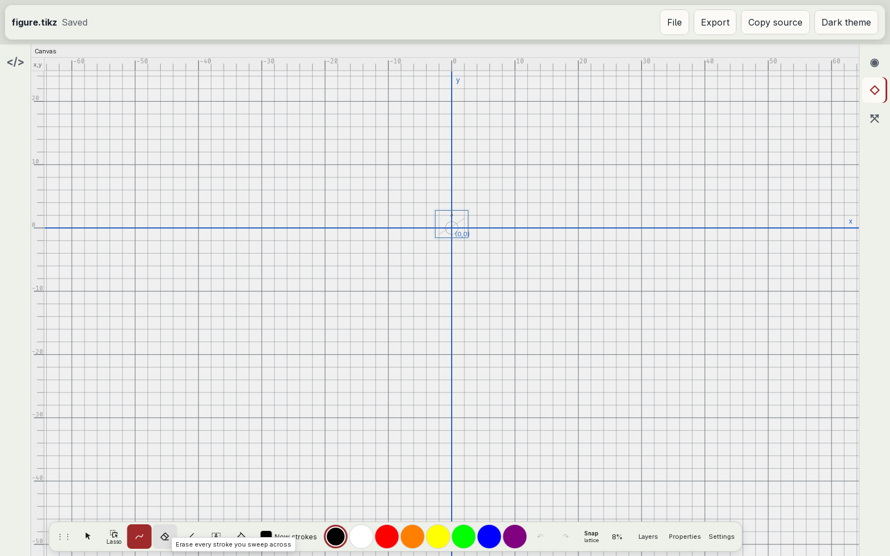
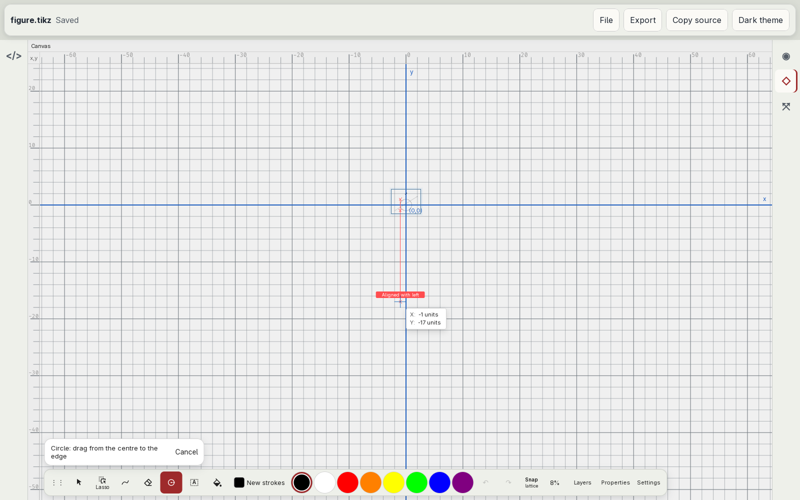
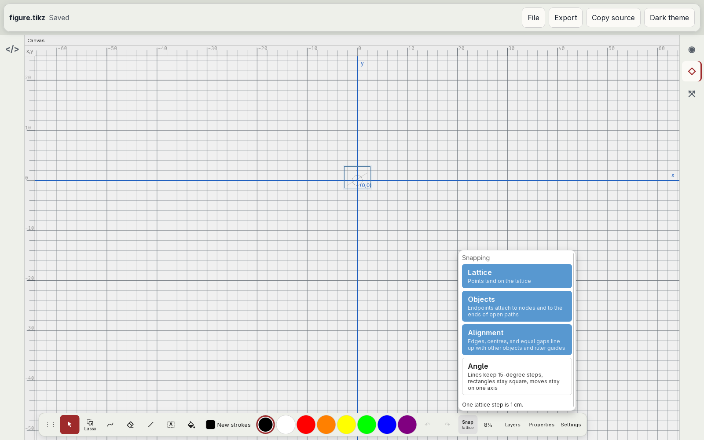
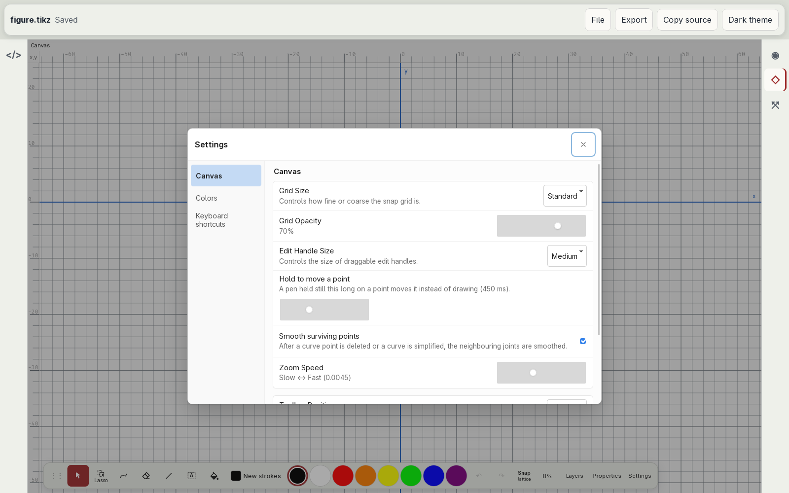
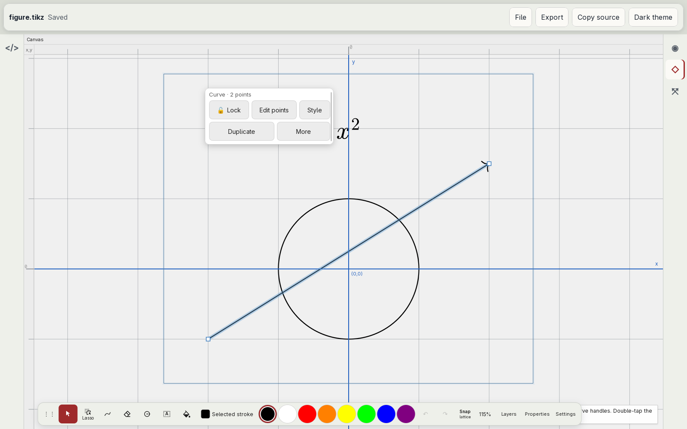
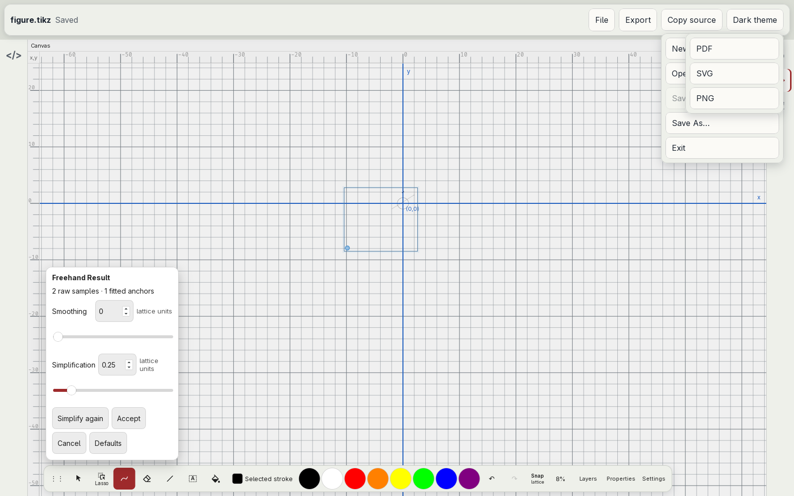

# Instructional text

Audit of the text the editor shows to explain itself ([#21](https://github.com/dzackgarza/visual-tikz-editor/issues/21), part of [#17](https://github.com/dzackgarza/visual-tikz-editor/issues/17)): tooltips, step text, hints, and the descriptions under options. The specification at the end replaces every earlier rule about this text. Where [the interaction model](../interaction-model.md) disagrees, this document holds; its "Constructing" row asks the dock and Properties to show an instruction for every stage, and [#25](https://github.com/dzackgarza/visual-tikz-editor/issues/25) rewrites it. Messages about the document (errors, conflicts, confirmations) belong to the [shell specification](shell.md) item 10.

## The text today

Captured in the installed desktop app at 1600×1000 with a fresh profile and a figure of a circle, an arrow, and the node `$x^2$`.

| Surface | Screenshot |
| --- | --- |
| Eraser tooltip |  |
| Circle construction |  |
| Snapping popover |  |
| Settings |  |
| Path selected |  |
| Freehand result |  |

Source: fork `.cache/tikz-editor/packages/app/src/ui/` unless a path says otherwise.

- **Tooltips.** Every dock tool has its name as tooltip ("Select", "Lasso selection", "Circle") except the eraser: "Erase every stroke you sweep across" (`tool-config.tsx:258-277`). No tooltip shows a shortcut. The eraser erases part of a stroke, so the tooltip also states the wrong behaviour ([dock specification](drawing-dock.md), departures).
- **Step lane.** During a construction the dock grows a lane with the tool name and the stage, for example "Circle: drag from the centre to the edge", "Path: place the next point, drag to bend, or tap the start to close", and a Cancel button (`Toolbar.tsx:749-753`, `canvas-panel/canvas-session.ts:234-256`). Text opens a "Label" picker first, then shows "Text: tap to place".
- **Properties hint box.** With a creation tool active, Properties repeats the stage text, or "Press and drag to draw" and "Hold and drag to magnify the canvas" (`inspector-panel/InspectorPanel.tsx:1846-1857`, `tool-config.tsx:395-398`).
- **Path hint.** A selected path shows "Drag square points or round curve handles. Double-tap the curve to add a point." in a box over the canvas at the bottom right, under the dock (`canvas-panel/path-selection-hint.ts:25`, `canvas-panel/CanvasPanelView.tsx:1091`).
- **Snapping.** Each rule carries a description: "Points land on the lattice", "Endpoints attach to nodes and to the ends of open paths", "Edges, centres, and equal gaps line up with other objects and ruler guides", "Lines keep 15-degree steps, rectangles stay square, moves stay on one axis". The popover ends with "One lattice step is 1 cm." (`SnapControl.tsx:22-25,44-52`; `packages/core/src/edit/lattice-units.ts:34`).
- **Settings.** Each row has a sentence under it: "Controls how fine or coarse the snap grid is.", "Controls the size of draggable edit handles.", "A pen held still this long on a point moves it instead of drawing (450 ms).", "After a curve point is deleted or a curve is simplified, the neighbouring joints are smoothed.", "Edge of the canvas the drawing rail docks to.", "Spaces before each line the editor writes into the source." A slider shows its raw internal value: "Slow ↔ Fast (0.0045)" (`SettingsModal.tsx:132-245`).
- **Keyboard shortcuts.** The panel opens with "Choose a command, then press its new keys. Escape cancels recording. Touch controls remain available." (`KeyboardShortcutsSettings.tsx:41`).
- **Geometry construction.** With lattice lock on: "Lattice lock keeps centers and defining points on integer coordinates; arc angles choose exact lattice points on the fixed circle." (`inspector-panel/GeometryConstructionControls.tsx:97`).
- **Freehand result.** "2 raw samples · 1 fitted anchors", sliders in "lattice units", and "This curve is already as simple as Simplify can make it." (`canvas-panel/CanvasPanel.tsx:5384-5413`).
- **Measurements.** The drag readout reads "X: -1 units Y: -17 units"; the number is in centimetres (`canvas-panel/interaction-helpers.ts:577-584`).
- **Unavailable views.** Quiver for a tikzpicture and Canvas for a tikzcd open a panel "… cannot edit this diagram" with the reason, for example "The visual editor is for tikzpicture diagrams; tikzcd uses Quiver" or "Quiver edits tikzcd diagrams; this block is tikz." (`src/ui/TikzWorkbench.vue:71-76`, `src/preview-modes.ts:74-77`, `src/quiver-bridge.ts:91` in this repository).
- **The upstream status bar.** Upstream tikz-editor shows the selection hint ("Double-click path to add a point.") and modifier hints ("Shift draw a square · Ctrl ignore snapping") in a status bar under the canvas (`StatusBar.tsx` at upstream `be197d85`). The embed hides that bar (`App.tsx:1889`) and shows the same kind of text in the dock, in Properties, and over the canvas.

Upstream panels that no control in the inspected interface opens (Assistant, Styles, Developer, and the PNG and SVG export dialogs) were not audited.

## Prior art

### Captured on this host

| Application | Evidence | What the audit takes from it |
| --- | --- | --- |
| Inkscape 1.4.4 (dcaf3e7d9e) | [eraser tooltip, tool controls, status bar](images/inkscape-eraser.png); [rectangle status hint](images/inkscape-status-hint.png); `/usr/share/inkscape/ui/toolbar-snap.ui`, `toolbar-eraser.ui`, `statusbar.ui`; `src/ui/widget/status-bar.cpp`, `src/ui/tools/rect-tool.cpp`, `src/ui/dialog/document-properties.cpp` | A tool tooltip is the name in bold, one verb phrase, and the shortcut: "Eraser Tool / Erase objects or paths (Shift+E)", "Pencil Tool / Draw freehand lines (P)". Tool controls show a label and a unitless value ("Width: 10", "Thinning: 0", "Mass: 3"); their explanations are pointer tooltips ("The width of the eraser pen (relative to the visible canvas area)", `toolbar-eraser.ui:138`). The snapping popover lists 20 labels ("Bounding boxes", "Path intersections", "Grids") with no descriptions and no tooltips. The next step for the active tool is one sentence in the status bar under the canvas: "Drag to erase.", "Adjust the width and height of the rectangle; with Ctrl to lock ratio or stretch in one dimension only". The message holds up to two lines and ends in an ellipsis when longer (`statusbar.ui:105-107`); its tooltip holds the full text (`status-bar.cpp:176-177`). The order is layer, message, then the pointer position, zoom, and rotation. The pointer position has no unit: "X: 5397.50 Y: -1640.42" (`status-bar.cpp:184-190`, `%7.2f`). During a drag the rectangle size carries the display unit: "Rectangle: %s × %s" from `Quantity::string(display_units)` (`rect-tool.cpp:341-344,383`). Document Properties › Grids edits "Spacing X" and "Spacing Y" (`document-properties.cpp:213,2016-2017`). |
| Ipe 7.2.30 | [window](images/ipe-7.2.30.png); survey section 12 | The status bar names the mode and explains the keys of the current step through `ui:explain()`: "Left: add vtx \| Del: delete vtx \| Right, Ctrl-Left, or Double-Left: final vtx". Nothing is drawn over the canvas. |
| tikz-editor (upstream) | `StatusBar.tsx` at `be197d85` | The same model: the hint, then "Modifiers:" and the keys, in the left group of a status bar under the canvas. The modifier keys show only during a canvas drag (`resolveModifierHint`), for example `${keys.shift} draw a square · ${keys.primary} ignore snapping`. The selection hint reads "Double-click path to add a point." (`path-selection-hint.ts:48`). Upstream shows no pointer position. |

### Documented behaviour

| Question | Convention | Sources |
| --- | --- | --- |
| Teaching | "Teach through interactivity." "Consider providing a collection of context-specific tips instead of a single onboarding flow." | [HIG Onboarding](https://developer.apple.com/design/human-interface-guidelines/onboarding) |
| Context help | "directly relate the help you provide to the precise action or task people are doing right now and make it easy for people to dismiss or avoid the help"; "Keep your tips to one or two sentences" | [HIG Offering help](https://developer.apple.com/design/human-interface-guidelines/offering-help) |
| Standard controls | "Avoid bloating your help content by explaining how standard components or patterns work." | HIG Offering help |
| Tooltips | A tooltip "briefly describes how to use a component"; "Explain the action or task the control initiates"; "begin the description with a verb"; "limit tooltip content to a maximum of 60 to 75 characters"; "In general, avoid repeating a control's name in its tooltip" | HIG Offering help |
| Eraser and tool options | Named options: Pixel/Object (Apple), Precision/Standard/Stroke (GoodNotes), Partial/Whole (Notability), Point/Stroke (OneNote). The survey links a primary source only for GoodNotes and Xournal++ | Survey section 4 |
| Recording a shortcut | The prompt appears when recording starts, in a centred overlay of 400 × 110 px: "Press desired key combination and then press ENTER." (137-138, 169, 214-220). Enter confirms (96-97, 178). Escape clears a recorded combination, and hides the overlay when none is recorded (`clearOrHide`, 276-285) | VS Code at 10cda960 [`keybindingWidgets.ts`](https://github.com/microsoft/vscode/blob/10cda960cfa7f133ab9dedcb01adff0b900c2186/src/vs/workbench/contrib/preferences/browser/keybindingWidgets.ts) |
| States and events | Banners for persistent states, toasts for single events | [Shell specification](shell.md) item 10 |

## Departures

| Text | Today | Convention | Departure |
| --- | --- | --- | --- |
| Eraser tooltip | A behaviour sentence, and the wrong behaviour | Name, one verb phrase, shortcut | Explanation in a tooltip; no shortcut |
| Next-step text | In the dock lane and again in Properties | One line in a status bar under the canvas | Two surfaces, neither a status line |
| Selection hint | A box over the canvas, under the dock | Status bar | Overlay hides content |
| Standard handles | "Drag square points or round curve handles" | Do not explain standard components | Explains handles |
| Option descriptions | A sentence under every snap rule, settings row, and construction field | Labels and values; explanations in pointer tooltips | Repaired |
| Read-only notes | "This figure's lattice is skewed; set grid steps in the source." and "This figure's lattice is skewed on this axis; move the element on the canvas instead." under a property | Labels and values | Sentences under an option |
| Lattice step | A read-only value in Document Properties, rounded to three decimals | Editable Spacing X and Y with a unit (Inkscape Grids) | Read-only |
| Internal values | "(0.0045)", "2 raw samples · 1 fitted anchors" | Labels and values | Repaired |
| Units | "units" for a number in cm | Values in the document's display unit (Inkscape) | Repaired |
| Shortcut recording | "Press the new shortcut" in the row; a combination without a conflict is assigned at once | VS Code: the prompt, then Enter confirms; Escape first clears | No confirmation step |
| Unavailable view | Error panel explaining which view to use | The view is not offered ([shell](shell.md) item 7) | Explains a dead end |

## Specification

1. **One rule.** The interface teaches through its controls and tells the next step only while a task runs. A control shows a name; an option shows a label and its value; the next step of the current task is one sentence in the status line. No other surface carries explanatory sentences: no description under an option, no instruction paragraph, no box over the canvas.
2. **Status line.** A status line of fixed height under the Canvas view, in every host. Left: the next step of the active tool or selection, one sentence that starts with a verb, as in Inkscape ("Drag to erase."). Then, during a canvas drag only, "Modifiers:" and the keys for the drag, in upstream's words (`Shift draw a square · Ctrl ignore snapping`). Right: the pointer position as X and Y in figure coordinates with no unit, as Inkscape shows it. The order follows upstream for the hint and the modifiers and Inkscape for the message before the position. The message holds up to two lines and ends in an ellipsis when longer, with the full text in its tooltip, as in Inkscape. The line never moves the canvas: with nothing to say, it is empty but keeps its height ([shell specification](shell.md) item 10).
3. **Status line content.** The construction stages of `constructionInstruction`, as sentences that start with a verb ("Drag from the centre to the edge.", "Place the second point."); the tool texts "Drag to draw." and "Drag to magnify."; for a selected path "Double-tap the curve to add a point." These texts are the project's own, in Inkscape's pattern; the path text is upstream's "Double-click path to add a point." with the touch gesture. "Drag square points or round curve handles" is deleted, as HIG says not to explain standard components. The dock step lane loses its text ([#31](https://github.com/dzackgarza/visual-tikz-editor/issues/31)); the Properties hint box and the canvas hint overlay are deleted.
4. **Tooltips.** Pointer only. The name, one verb phrase, and the shortcut when one exists, as in Inkscape ("Eraser Tool / Erase objects or paths (Shift+E)"). The dock shows icons only, so the tooltip is the one place the name shows and does not repeat a visible name. The verb phrase explains the action the control starts and keeps the tooltip within HIG's 60 to 75 characters. The eraser reads "Eraser" and "Erase strokes"; these words are the project's own.
5. **Option labels.** The snapping popover, Settings, the tool options popovers, the Geometry construction controls, Properties, and the Freehand result popover show a label and a value, and no sentence under an option. Where an option needs an explanation, it is the option's pointer tooltip, as Inkscape explains its eraser controls (`toolbar-eraser.ui:138`); the snap rules have none, as in Inkscape's snapping popover. A slider shows its number, as Inkscape's tool controls do, with the unit of item 7 when the number has one. The sample and anchor counts and "This curve is already as simple as Simplify can make it." are deleted; Simplify is disabled when it has no effect, as HIG The menu bar disables a command that cannot act.
6. **Lattice step.** The lattice step is a figure property in Document Properties ([#50](https://github.com/dzackgarza/visual-tikz-editor/issues/50)), not a sentence in the snapping popover. Its X and Y are editable values in cm, as Inkscape's Document Properties › Grids edits "Spacing X" and "Spacing Y" with a unit; an edit writes the figure's `x` and `y` options. A lattice axis that is skewed has no single canvas-axis step, so its value is read-only and shows no sentence; this case is the project's own, since Inkscape grids are not skewed.
7. **Units.** A displayed value is in the document's display unit, as Inkscape shows drag sizes in its display unit (`rect-tool.cpp:341-344`). The figure's display unit is its coordinate unit, which TikZ writes with no unit word, so coordinates, drag readouts, and the pointer position show bare numbers, as Inkscape's pointer position has no unit. A value in another unit names it: centimetres as "cm", points as "pt", time as "ms". The word "units" alone is not used.
8. **Shortcut recording.** The instruction paragraph is deleted. When a row starts recording, its field shows VS Code's prompt "Press desired key combination and then press Enter."; the field is the project's place for it, where VS Code uses an overlay. The pressed combination shows in the field, and Enter assigns it. Escape clears a recorded combination, and cancels recording when none is recorded, as VS Code's `clearOrHide` does.
9. **Views and errors.** Views that cannot edit the document are not offered ([#44](https://github.com/dzackgarza/visual-tikz-editor/issues/44)), so the unavailable panel and its explanations are deleted. A remaining failure of an offered view, such as a tikzcd that Quiver cannot map to source lines, is a banner ([#47](https://github.com/dzackgarza/visual-tikz-editor/issues/47)).

## Implementation issues

An issue that names a dependency starts after that audit has its specification.

| Items | Issue | Depends on |
| --- | --- | --- |
| 1–3 | [#52](https://github.com/dzackgarza/visual-tikz-editor/issues/52) Status line under the Canvas view | — |
| 4 | [#28](https://github.com/dzackgarza/visual-tikz-editor/issues/28) Dock contents as icons (tooltip format) | #22 |
| 3 | [#31](https://github.com/dzackgarza/visual-tikz-editor/issues/31) Step text to a status line | #52 |
| 9 | [#44](https://github.com/dzackgarza/visual-tikz-editor/issues/44), [#47](https://github.com/dzackgarza/visual-tikz-editor/issues/47) | #23, this audit |
| 5, 6, 8 | [#53](https://github.com/dzackgarza/visual-tikz-editor/issues/53) Labels and values only on option surfaces; delete description sentences | — |
| 7 | [#54](https://github.com/dzackgarza/visual-tikz-editor/issues/54) Name the unit of every displayed measurement | — |
