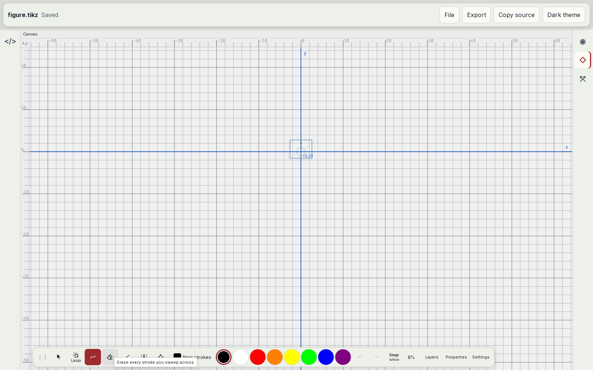
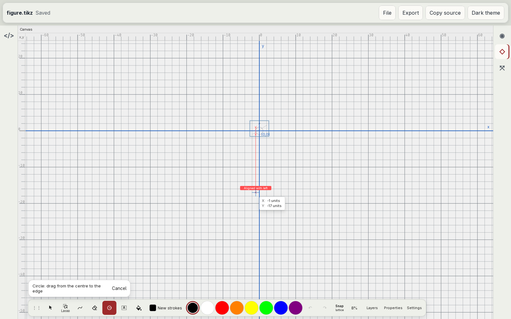
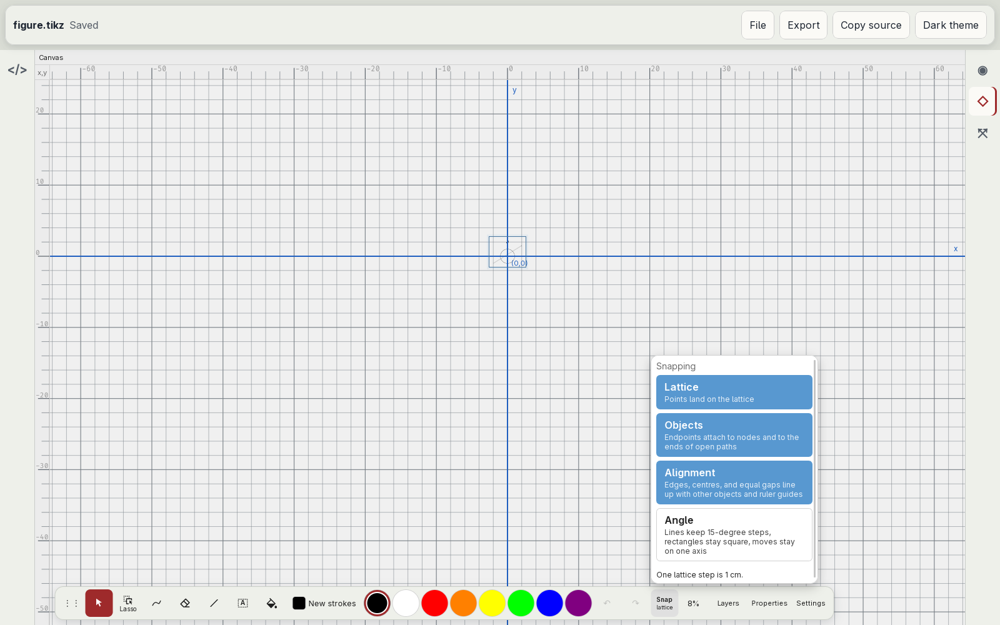
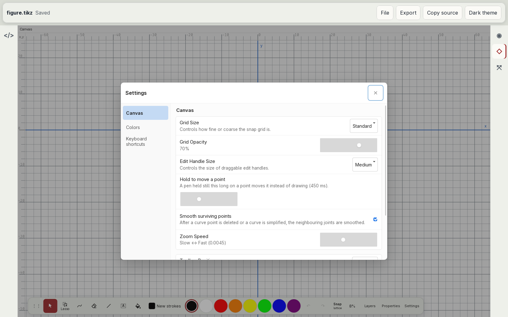
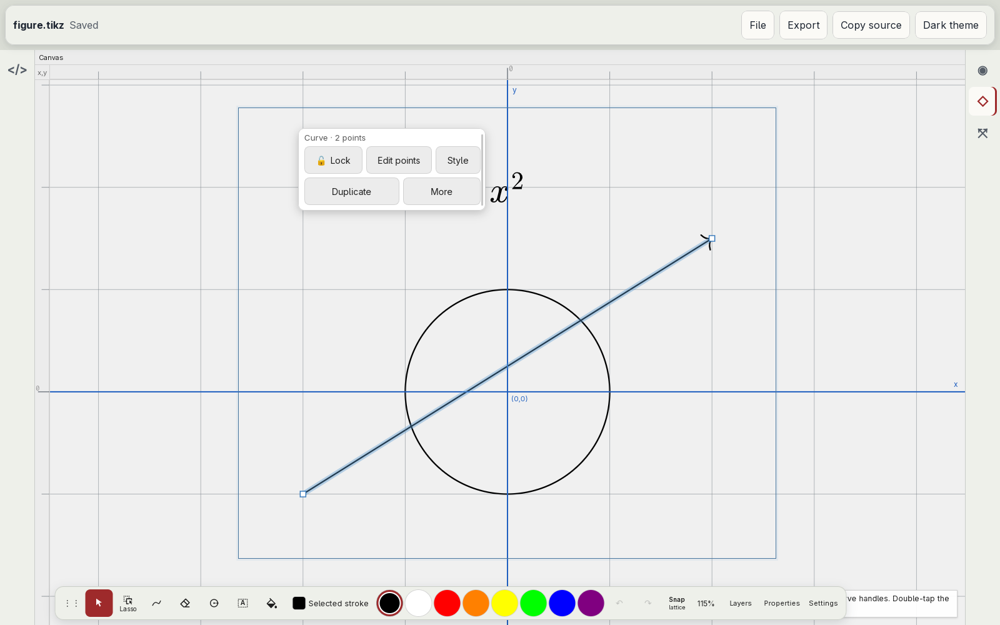
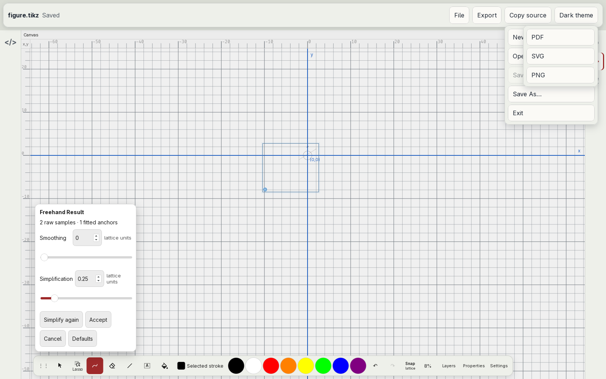

# Instructional text

Audit of the text the editor shows to explain itself ([#21](https://github.com/dzackgarza/visual-tikz-editor/issues/21), part of [#17](https://github.com/dzackgarza/visual-tikz-editor/issues/17)): tooltips, step text, hints, and the descriptions under options. The specification at the end replaces every earlier rule about this text. Where [the interaction model](../interaction-model.md) disagrees, this document holds; its "Constructing" row asks the dock and Properties to show an instruction for every stage, and [#25](https://github.com/dzackgarza/visual-tikz-editor/issues/25) rewrites it. Messages about the document (errors, conflicts, confirmations) belong to the [shell specification](shell.md) item 10.

## The text today

Captured in the installed desktop app at 1600×1000 with a fresh profile and a figure of a circle, an arrow, and the node `$x^2$`.

| Surface | Screenshot |
| --- | --- |
| Eraser tooltip |  |
| Circle construction |  |
| Snapping popover |  |
| Settings |  |
| Path selected |  |
| Freehand result |  |

Source: fork `.cache/tikz-editor/packages/app/src/ui/` unless a path says otherwise.

- **Tooltips.** Every dock tool has its name as tooltip ("Select", "Lasso selection", "Circle") except the eraser: "Erase every stroke you sweep across" (`tool-config.tsx:258-277`). No tooltip shows a shortcut. The eraser erases part of a stroke, so the tooltip also states the wrong behaviour ([dock specification](drawing-dock.md), departures).
- **Step lane.** During a construction the dock grows a lane with the tool name and the stage, for example "Circle: drag from the centre to the edge", "Path: place the next point, drag to bend, or tap the start to close", and a Cancel button (`Toolbar.tsx:749-753`, `canvas-panel/canvas-session.ts:234-256`). Text opens a "Label" picker first, then shows "Text: tap to place".
- **Properties hint box.** With a creation tool active, Properties repeats the stage text, or "Press and drag to draw" and "Hold and drag to magnify the canvas" (`inspector-panel/InspectorPanel.tsx:1846-1857`, `tool-config.tsx:395-398`).
- **Path hint.** A selected path shows "Drag square points or round curve handles. Double-tap the curve to add a point." in a box over the canvas at the bottom right, under the dock (`canvas-panel/path-selection-hint.ts:25`, `canvas-panel/CanvasPanelView.tsx:1091`).
- **Snapping.** Each rule carries a description: "Points land on the lattice", "Endpoints attach to nodes and to the ends of open paths", "Edges, centres, and equal gaps line up with other objects and ruler guides", "Lines keep 15-degree steps, rectangles stay square, moves stay on one axis". The popover ends with "One lattice step is 1 cm." (`SnapControl.tsx:22-25,44-52`; `packages/core/src/edit/lattice-units.ts:34`).
- **Settings.** Each row has a sentence under it: "Controls how fine or coarse the snap grid is.", "Controls the size of draggable edit handles.", "A pen held still this long on a point moves it instead of drawing (450 ms).", "After a curve point is deleted or a curve is simplified, the neighbouring joints are smoothed.", "Edge of the canvas the drawing rail docks to.", "Spaces before each line the editor writes into the source." A slider shows its raw internal value: "Slow ↔ Fast (0.0045)" (`SettingsModal.tsx:132-245`).
- **Keyboard shortcuts.** The panel opens with "Choose a command, then press its new keys. Escape cancels recording. Touch controls remain available." (`KeyboardShortcutsSettings.tsx:41`).
- **Geometry construction.** With lattice lock on: "Lattice lock keeps centers and defining points on integer coordinates; arc angles choose exact lattice points on the fixed circle." (`inspector-panel/GeometryConstructionControls.tsx:97`).
- **Freehand result.** "2 raw samples · 1 fitted anchors", sliders in "lattice units", and "This curve is already as simple as Simplify can make it." (`canvas-panel/CanvasPanel.tsx:5384-5413`).
- **Measurements.** The drag readout reads "X: -1 units Y: -17 units"; the number is in centimetres (`canvas-panel/interaction-helpers.ts:577-584`).
- **Unavailable views.** Quiver for a tikzpicture and Canvas for a tikzcd open a panel "… cannot edit this diagram" with the reason, for example "The visual editor is for tikzpicture diagrams; tikzcd uses Quiver" or "Quiver edits tikzcd diagrams; this block is tikz." (`src/ui/TikzWorkbench.vue:71-76`, `src/preview-modes.ts:74-77`, `src/quiver-bridge.ts:91` in this repository).
- **The upstream status bar.** Upstream tikz-editor shows the selection hint ("Double-click path to add a point.") and modifier hints ("Shift draw a square · Ctrl ignore snapping") in a status bar under the canvas (`StatusBar.tsx` at upstream `be197d85`). The embed hides that bar (`App.tsx:1889`) and shows the same kind of text in the dock, in Properties, and over the canvas.

Upstream panels that no control in the inspected interface opens (Assistant, Styles, Developer, and the PNG and SVG export dialogs) were not audited.

## Prior art

### Captured on this host

| Application | Evidence | What the audit takes from it |
| --- | --- | --- |
| Inkscape 1.4.4 | [eraser tooltip, tool controls, status bar](images/inkscape-eraser.png); [rectangle status hint](images/inkscape-status-hint.png); `/usr/share/inkscape/ui/toolbar-snap.ui`, `toolbar-eraser.ui` | A tool tooltip is the name in bold, one verb phrase, and the shortcut: "Eraser Tool / Erase objects or paths (Shift+E)", "Pencil Tool / Draw freehand lines (P)". Tool controls carry a label and a value ("Width: 10", "Thinning: 0"), no sentences. The snapping popover lists 20 labels ("Bounding boxes", "Path intersections", "Grids") and no descriptions. The next step for the active tool is one sentence in the status bar under the canvas: "Drag to erase.", "Adjust the width and height of the rectangle; with Ctrl to lock ratio or stretch in one dimension only". The pointer position is in the status bar: "X: 5397.50 Y: -1640.42". |
| Ipe 7.2.30 | [window](images/ipe-7.2.30.png); survey section 12 | The status bar names the mode and explains the keys of the current step through `ui:explain()`: "Left: add vtx \| Del: delete vtx \| Right, Ctrl-Left, or Double-Left: final vtx". Nothing is drawn over the canvas. |
| tikz-editor (upstream) | `StatusBar.tsx` at `be197d85` | The same model: hints and modifier keys in a status bar under the canvas. |

### Documented behaviour

| Question | Convention | Sources |
| --- | --- | --- |
| Teaching | "Teach through interactivity." "Consider providing a collection of context-specific tips instead of a single onboarding flow." | [HIG Onboarding](https://developer.apple.com/design/human-interface-guidelines/onboarding) |
| Context help | "directly relate the help you provide to the precise action or task people are doing right now and make it easy for people to dismiss or avoid the help"; "Keep your tips to one or two sentences" | [HIG Offering help](https://developer.apple.com/design/human-interface-guidelines/offering-help) |
| Standard controls | "Avoid bloating your help content by explaining how standard components or patterns work." | HIG Offering help |
| Tooltips | "limit tooltip content to a maximum of 60 to 75 characters"; "begin the description with a verb" | HIG Offering help |
| Eraser and tool options | Named options only: Pixel/Object (Apple), Precision/Standard/Stroke (GoodNotes), Partial/Whole (Notability), Point/Stroke (OneNote); none carries an explanation | Survey section 4 |
| Recording a shortcut | The prompt appears when recording starts, in the recording field: "Press desired key combination and then press ENTER." | VS Code [`keybindingWidgets.ts`](https://github.com/microsoft/vscode/blob/main/src/vs/workbench/contrib/preferences/browser/keybindingWidgets.ts) |
| States and events | Banners for persistent states, toasts for single events | [Shell specification](shell.md) item 10 |

## Departures

| Text | Today | Convention | Departure |
| --- | --- | --- | --- |
| Eraser tooltip | A behaviour sentence, and the wrong behaviour | Name, one verb phrase, shortcut | Explanation in a tooltip; no shortcut |
| Next-step text | In the dock lane and again in Properties | One line in a status bar under the canvas | Two surfaces, neither a status line |
| Selection hint | A box over the canvas, under the dock | Status bar | Overlay hides content |
| Standard handles | "Drag square points or round curve handles" | Do not explain standard components | Explains handles |
| Option descriptions | A sentence under every snap rule, settings row, and construction field | Labels and values | Descriptions everywhere |
| Lattice step | A sentence in the snapping popover | A value with the document's grid settings | Figure property shown as prose |
| Internal values | "(0.0045)", "2 raw samples · 1 fitted anchors" | Values in user units, or none | Implementation detail |
| Units | "units" for a number in cm | The unit named | Wrong or vague unit |
| Shortcut panel | Instruction paragraph before any action | Prompt at the moment of recording | Instruction ahead of the task |
| Unavailable view | Error panel explaining which view to use | The view is not offered ([shell](shell.md) item 7) | Explains a dead end |

## Specification

1. **One rule.** The interface teaches through its controls and tells the next step only while a task runs. A control shows a name; an option shows a label and its value; the next step of the current task is one sentence in the status line. No other surface carries explanatory sentences: no description under an option, no instruction paragraph, no box over the canvas.
2. **Status line.** One line of fixed height under the Canvas view, in every host. Left: the next step of the active tool or selection, one sentence that starts with a verb, as in Inkscape ("Drag to erase."). Then the modifier keys for the step, as upstream ("Shift: square · Ctrl: ignore snapping"). Right: the pointer position with its unit. The line never wraps and never moves the canvas; text longer than the line is ellipsised. With nothing to say, the line is empty but keeps its height.
3. **Status line content.** The construction stages of `constructionInstruction`, as sentences ("Drag from the centre to the edge."); the tool texts "Drag to draw." and "Drag to magnify."; for a selected path "Double-tap the curve to add a point." The variant name comes first when the tool has variants ("Circle by three points: place the second point."). "Drag square points or round curve handles" is deleted. The dock step lane loses its text ([#31](https://github.com/dzackgarza/visual-tikz-editor/issues/31)); the Properties hint box and the canvas hint overlay are deleted.
4. **Tooltips.** Pointer only. The name, one verb phrase of at most 60 characters, and the shortcut when one exists, as in Inkscape ("Eraser Tool / Erase objects or paths (Shift+E)"). The eraser reads "Eraser" and "Erase strokes". The verb phrase states what the tool does, never how to use it.
5. **Option labels.** The snapping popover, Settings, the tool options popovers, the Geometry construction controls, and the Freehand result popover show labels and values only. Their description sentences are deleted. A slider shows its value in a user unit (ms, cm, pt) or shows no number. The sample and anchor counts and "This curve is already as simple as Simplify can make it." are deleted; Simplify is disabled when it has no effect.
6. **Lattice step.** The lattice step is a figure property shown as a value in Document Properties ([#50](https://github.com/dzackgarza/visual-tikz-editor/issues/50)), not a sentence in the snapping popover.
7. **Units.** Every displayed measurement names its unit, and the unit is the one the number is in: centimetres as "cm", TikZ coordinates as the figure's coordinates with no unit word. The word "units" alone is not used.
8. **Shortcut recording.** The instruction paragraph is deleted. When a row starts recording, its field shows "Press the new shortcut", as VS Code shows its prompt only at recording time; Escape cancels.
9. **Views and errors.** Views that cannot edit the document are not offered ([#44](https://github.com/dzackgarza/visual-tikz-editor/issues/44)), so the unavailable panel and its explanations are deleted. A remaining failure of an offered view, such as a tikzcd that Quiver cannot map to source lines, is a banner ([#47](https://github.com/dzackgarza/visual-tikz-editor/issues/47)).

## Implementation issues

An issue that names a dependency starts after that audit has its specification.

| Items | Issue | Depends on |
| --- | --- | --- |
| 1–3 | Status line under the Canvas view | — |
| 1, 5, 6, 8 | Labels and values only on option surfaces | #50 |
| 7 | Name the unit of every displayed measurement | — |
| 4 | [#28](https://github.com/dzackgarza/visual-tikz-editor/issues/28) Dock contents as icons (tooltip format) | #22 |
| 3 | [#31](https://github.com/dzackgarza/visual-tikz-editor/issues/31) Step text to a status line | this audit |
| 9 | [#44](https://github.com/dzackgarza/visual-tikz-editor/issues/44), [#47](https://github.com/dzackgarza/visual-tikz-editor/issues/47) | #23, this audit |
