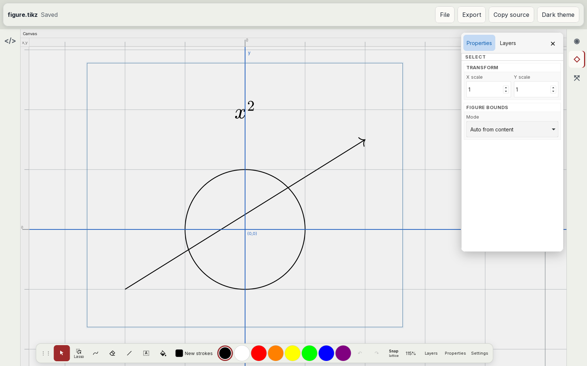
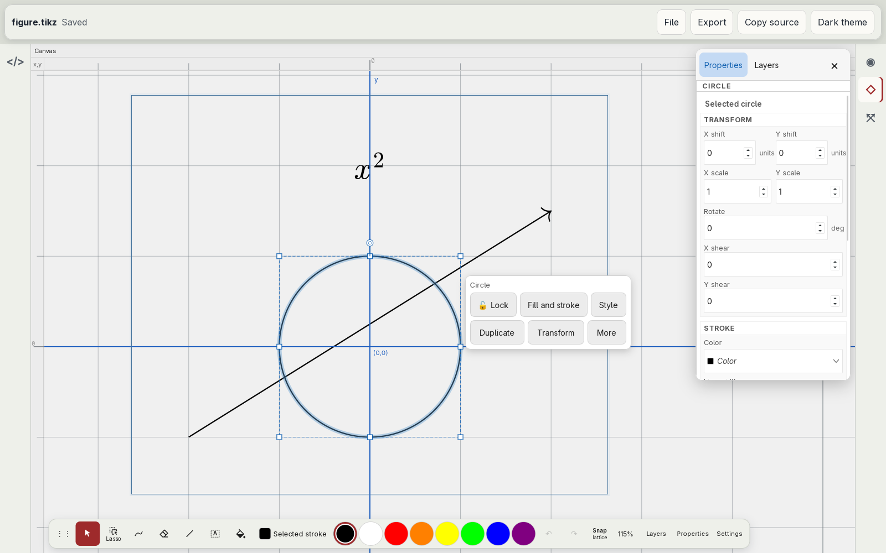
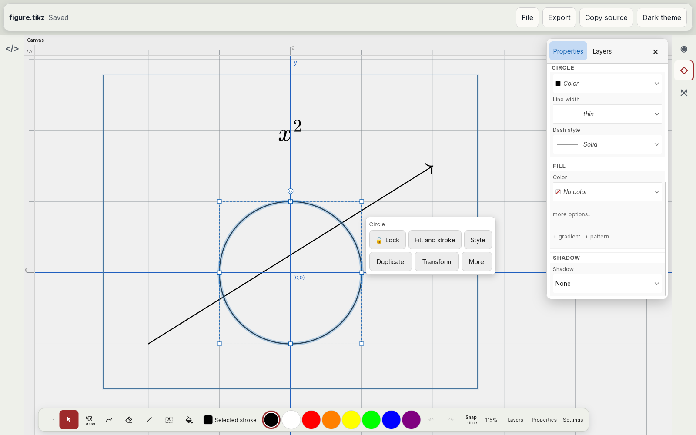
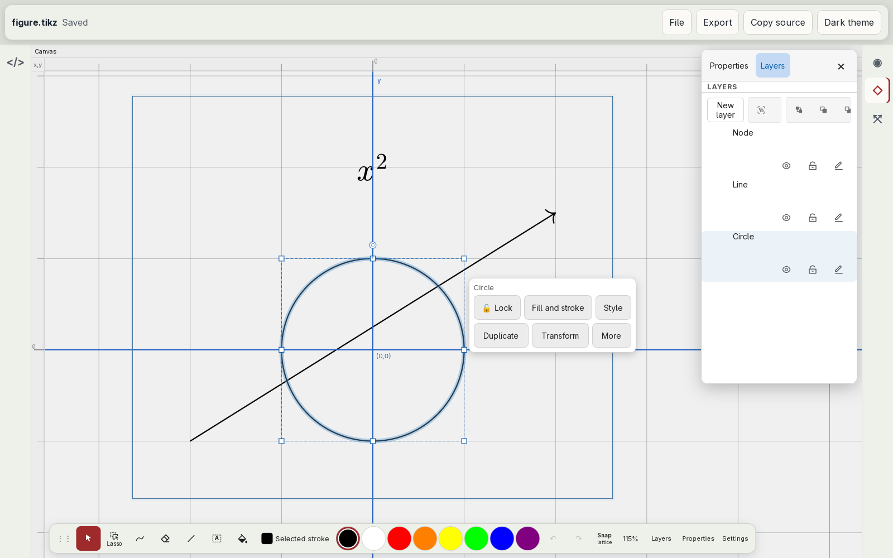
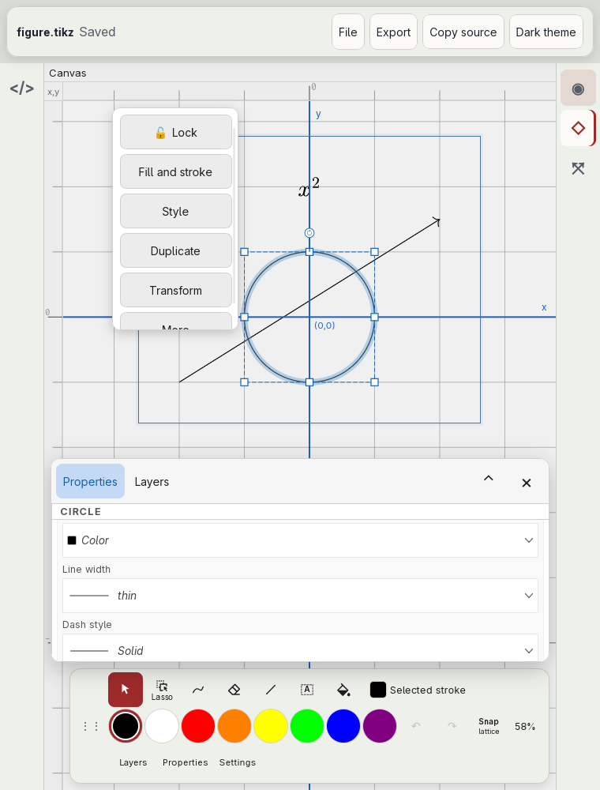

# Properties and Layers panels

Audit of the Properties and Layers panels against established vector-editor and tablet conventions ([#20](https://github.com/dzackgarza/visual-tikz-editor/issues/20), part of [#17](https://github.com/dzackgarza/visual-tikz-editor/issues/17)). The specification at the end replaces every earlier rule about these panels. Where [the interaction model](../interaction-model.md) disagrees, this document holds; [#25](https://github.com/dzackgarza/visual-tikz-editor/issues/25) rewrites the model and its stories. The buttons that open the panels are specified in [the drawing dock](drawing-dock.md).

## The panels today

Captured in the installed desktop app at 1600×1000 and at 760×1000, with a figure of a circle, an arrow, and the node `$x^2$`.

| State | Screenshot |
| --- | --- |
| Properties, nothing selected |  |
| Properties, circle selected |  |
| Properties, circle selected, scrolled |  |
| Layers, circle selected |  |
| Portrait window |  |

Source: fork `packages/app/src/ui/DockLayout.tsx:694-718`, `inspector-panel/InspectorPanel.tsx`, `inspector-panel/InspectorSections.tsx`, `objects-panel/ObjectsPanel.tsx`, and `src/ui/TikzWorkbench.vue:77-91` in this repository.

- **One container.** One card holds two text tabs, "Properties" and "Layers", and a "×". In landscape the card floats over the right of the canvas; the canvas runs on beneath it. In portrait it is a bottom sheet with "⌃"/"⌄" to expand and "×" to close.
- **Opening and closing.** The dock buttons Layers and Properties open the card on their tab. A second press leaves it open. A tap on the canvas and Escape leave it open. Only "×" closes it.
- **Two names.** The embed calls the panel "Properties"; the desktop layouts and the message "Inspector data is unavailable for the current selection" call it "Inspector".
- **Properties, nothing selected.** The header is the active tool's name ("SELECT"). Below it are Transform (X and Y scale of the whole figure) and Figure Bounds (Mode "Auto from content"). With a creation tool active, the panel shows a hint box and a "New strokes" section with stroke and fill pickers and the circle and arc construction controls.
- **Properties, selection.** The header is the type ("CIRCLE"), followed by the line "Selected circle". Transform (X/Y shift, X/Y scale, rotate, X/Y shear) comes first; then Stroke (colour, line width, dash), Fill (colour, "more options..", "+ gradient", "+ pattern"), and Shadow. Colours are dropdowns that read "Color" and "No color" in italics.
- **Layers.** The header row holds the word button "New layer" and icon buttons Group, Ungroup, Send to back, Send backward, Bring forward; the last is clipped by the panel edge. Every object in the figure is a row. Each row puts its name on one line and eye, lock, and pencil (rename) on a second line, about 93 px per row. Layer rows add Raise, Lower, "Move here", and Delete. A layer is a top-level `scope` with a `name=` option (fork `layers.ts`); that option compiles and does not name the nodes inside the scope.
- **Host state.** The panel belongs to the canvas editor, whose `inspector-closed` event the shell forwards to the host (`TikzWorkbench.vue:93-110`); the TeX render provider (`TikzCompilerPreview.vue`) has no panel. After "×", one host request opens the panel again (`test/hosted-browser.spec.ts`, `opens Properties on one host tap after the panel's own close button`).
- **Overlap with the selection strip.** The strip over a selection offers "Fill and stroke", "Style", and "Transform", which repeat sections of Properties. The strip belongs to [#24](https://github.com/dzackgarza/visual-tikz-editor/issues/24).

## Prior art

### Captured on this host

| Application | Screenshot | What the panel audit takes from it |
| --- | --- | --- |
| Ipe 7.2.30 (default profile) | [window](images/ipe-7.2.30.png) | Properties and Layers are two docked panels, Properties above Layers, each with its own title bar and close button. Properties shows the current attributes as rows of icon and value with no section headings: stroke and fill colour wells, pen width, dash, arrows, text size, mark shape and size, opacity. With nothing selected these are the attributes of the next object. Layers lists layers only: one row per layer with a visibility check box and the name. |
| Inkscape 1.4.4 (default profile) | [window](images/inkscape-1.4.4.png) | Fill and Stroke is a docked dialog at the right edge with its own tab and "×"; the canvas ends where the dock begins. With nothing selected it says "No objects". Its paint type is a row of icon buttons (none, flat, linear gradient, radial gradient, mesh, pattern, swatch, unset). The status bar shows the current layer, "Layer 1", with its eye and lock after it. |
| Xournal++ 1.3.8 (default profile) | [window](images/xournalpp-1.3.8.png) | Layers live in a sidebar tab and a footer selector, apart from the tool attributes in the toolbar. |

### Documented behaviour

| Question | Convention | Sources |
| --- | --- | --- |
| One panel or two | Separate surfaces in every application checked | Ipe and Inkscape captures; Xournal++, GoodNotes, Procreate, Concepts (survey on [#17](https://github.com/dzackgarza/visual-tikz-editor/issues/17#issuecomment-6824791310), section 7) |
| What an inspector shows | "An inspector displays the details of the currently selected item, automatically updating its contents when the item changes or when people select a new item." | [HIG Panels](https://developer.apple.com/design/human-interface-guidelines/panels) |
| Where an inspector sits | A panel or "a split view pane"; Keynote presents "the inspector pane in areas that surround the main slide canvas" | [HIG Panels](https://developer.apple.com/design/human-interface-guidelines/panels); [HIG Split views](https://developer.apple.com/design/human-interface-guidelines/split-views) |
| Panel title | A short noun; the menu command uses the title without "panel": "Show Fonts", "Show Inspector" | [HIG Panels](https://developer.apple.com/design/human-interface-guidelines/panels) |
| Panel controls | "Prefer simple adjustment controls in a panel" | [HIG Panels](https://developer.apple.com/design/human-interface-guidelines/panels) |
| Opening and closing | The button that opens a panel closes it; panels are listed as Show commands | Survey section 2; [HIG Toolbars](https://developer.apple.com/design/human-interface-guidelines/toolbars) "buttons that open nearby inspectors" |
| Supplementary panel on iPad | A nonmodal sheet: "in iOS and iPadOS, you can use a nonmodal sheet for this workflow"; Notes formats text from one while editing | [HIG Sheets](https://developer.apple.com/design/human-interface-guidelines/sheets) |
| Sheet size | Detents: "large is the height of a fully expanded sheet and medium is about half" | [HIG Sheets](https://developer.apple.com/design/human-interface-guidelines/sheets) |
| Sheet resize and dismissal | "Include a grabber in a resizable sheet"; people "can also tap it to cycle through the detents"; "People expect to swipe vertically to dismiss a sheet instead of tapping a dismiss button" | [HIG Sheets](https://developer.apple.com/design/human-interface-guidelines/sheets) |
| Inspector with nothing selected | The attributes of the next object (Ipe); "No objects" (Inkscape Fill and Stroke) | Captures |
| Figure size and page | A document properties dialog, not the selection inspector: Inkscape File > Document Properties; Ipe Edit > Document properties | Inkscape and Ipe menus |
| Colour fields | Colour wells (Ipe stroke and fill); a "none" paint button (Inkscape "×") | Captures; [HIG Color wells](https://developer.apple.com/design/human-interface-guidelines/color-wells) |
| Paint type | A row of paint type buttons | Inkscape capture; [Inkscape Fill & Stroke](https://inkscape-manuals.readthedocs.io/en/latest/fill-and-stroke-dialog.html) |
| Section order | Style first: Ipe stroke, fill, pen, dash, arrows; Inkscape Fill, Stroke paint, Stroke style | Captures |
| What Layers lists | Layers only (Ipe, Procreate, Xournal++, GoodNotes); or "a list of all layers and objects in the drawing" with "a button to toggle between 'Layers' and 'Objects' view" (Inkscape 1.2) | Ipe capture; [Procreate Layers](https://help.procreate.com/procreate/handbook/layers/layers-interface); [Inkscape 1.2 release notes](https://wiki.inkscape.org/wiki/Release_notes/1.2) |
| Row controls | On the row: Procreate "Visibility Checkbox", blend mode "on the right-hand side of a layer"; Inkscape "icons for locking and hiding a layer/object light up when you hover over the layer's row (when not locked or hidden)" | Procreate Layers; Inkscape 1.2 release notes |
| Renaming | "names … can be changed after a double-click on the current name" (Inkscape); Layer Options (Procreate) | Inkscape 1.2 release notes; Procreate Layers |
| Layer actions | "Tap it again to access the Layer Options menu" (Procreate); "the context (right-click) menu for layers provides options to move, delete, rename the current layer" (Inkscape) | Procreate Layers; Inkscape 1.2 release notes |
| Header buttons | "a button to toggle between 'Layers' and 'Objects' view" and "buttons to move objects up and down in the stack" | Inkscape 1.2 release notes |
| Current layer | A status-bar layer indicator with its lock and hide icons after it (Inkscape); a footer selector (Xournal++) | Inkscape capture and 1.2 release notes; Xournal++ capture |

Not verified from a primary source: how Procreate closes its Layers panel; the GoodNotes and Concepts layer row layouts.

## Departures

| Control | Today | Convention | Departure |
| --- | --- | --- | --- |
| Container | One card with Properties and Layers tabs | Two panels, each with its own title | Merged panels |
| Landscape placement | A card over the canvas; the canvas runs on beneath it | A docked pane beside the canvas (Ipe, Inkscape, Keynote) | Covers the canvas |
| Portrait placement | Bottom sheet with "⌃"/"⌄" and "×" | Nonmodal sheet with medium and large detents, a grabber, and swipe-down dismissal | Glyph buttons instead of a grabber; no swipe dismissal |
| Opening and closing | Dock buttons open only; "×" is the only close | The opening button toggles | No toggle |
| Name | "Properties" and "Inspector" | One title | Two names |
| Properties header, nothing selected | Active tool name | Next-object attributes (Ipe) or an empty state (Inkscape) | Tool name in a selection inspector |
| Figure scale and bounds | In Properties when nothing is selected | Document properties dialog | Wrong surface |
| Tool hint box and "New strokes" | In Properties while a creation tool is active | Next step in the status line; tool options on the tool (dock specification items 4, 5, 10) | Wrong surface |
| Properties header, selection | "CIRCLE" and "Selected circle" | One title | Repeated title |
| Section order | Transform first | Style first | Order |
| Colour fields | Dropdowns reading "Color", "No color" | Colour wells with a none state | Dropdowns |
| "more options..", "fewer options.." | Text links | Disclosure control | Link-styled toggles |
| "+ gradient", "+ pattern" | Text links | Paint type buttons (Inkscape) | Link-styled actions |
| Layers contents | Every object as a tree | Layers only, or a layers and objects tree with a view toggle (Inkscape) | No view toggle |
| Layers rows | Name on one line; eye, lock, pencil on a second line; about 93 px per row | One line per row; eye and lock on the row | Two lines per row |
| Rename | Pencil button on every row | Double-click or double-tap on the name; Layer Options | Extra button per row |
| Layer actions | Raise, Lower, "Move here", Delete buttons on every layer row | Row menu: Procreate Layer Options, Inkscape context menu | Buttons on every row |
| New layer | Word button "New layer" | Icon button | Word |
| Header actions | Group, Ungroup, and four stacking buttons; the last clipped | View toggle and up/down stacking buttons (Inkscape); Group in the object menu | Group in the panel header; clipped button |
| Host sync | The host follows `inspector-closed` | Host and panel state agree | Keep |

## Specification

1. **Two panels.** Properties and Layers are separate panels, each with its own title and close button. Each opens and closes from its own button (dock specification item 8, [#26](https://github.com/dzackgarza/visual-tikz-editor/issues/26)). The tab strip is deleted.
2. **Landscape.** An open panel is a docked pane at the trailing edge of the canvas, and the canvas ends where the pane begins. With both open, Properties sits above Layers in one column, as in Ipe. A canvas tap and Escape do not close a docked pane.
3. **Portrait.** An open panel is a nonmodal sheet above the dock, with medium and large detents and a grabber. A drag on the grabber resizes it, a tap on the grabber cycles the detents, and a swipe down closes it. One sheet is open at a time; opening the other panel replaces it. The "⌃"/"⌄" buttons are deleted.
4. **One name.** The panel is "Properties" in every build, layout, label, and message. The word "Inspector" leaves the interface.
5. **Properties with nothing selected.** Properties shows the attributes the next object gets: stroke colour, fill colour, line width, dash, and arrows, as in Ipe. It has no tool-name header. The figure's scale and bounds move to a Document properties dialog in the File menu ([#22](https://github.com/dzackgarza/visual-tikz-editor/issues/22)). The tool hint moves to the status line ([#21](https://github.com/dzackgarza/visual-tikz-editor/issues/21)); the construction controls move to the tool options ([#27](https://github.com/dzackgarza/visual-tikz-editor/issues/27)).
6. **Properties with a selection.** One title, the selection's type. Sections in order: Stroke, Fill, Shadow, Transform. Stroke and fill colours are colour wells that open the colour picker with its exact `xcolor` field; fill has a none state. Fill paint type is a row of icon buttons (none, flat, gradient, pattern). "more options.." and "fewer options.." become a disclosure control.
7. **Layers contents.** The panel lists the layers and objects of the figure as a tree, with a header toggle between the Layers view (layer rows only) and the Objects view (the full tree), as in Inkscape. A layer stays a top-level `scope` with a `name=` option, as an Inkscape layer is an SVG group marked `inkscape:groupmode="layer"`.
8. **Layers rows.** One line per row: disclosure, name, then eye and lock at the trailing end. Eye and lock are always visible on touch; with a pointer they show on hover or when hidden or locked. A double-click or double-tap on the name renames it. A second tap on a selected row, a long press, or a right-click opens the row menu: Rename, Raise, Lower, Move selection here, Delete. Drag reordering stays. The per-row pencil, Raise, Lower, "Move here", and Delete buttons are deleted.
9. **Layers header.** An add-layer icon button (`RiAddLine`), the view toggle, and stacking buttons (Send to back, Send backward, Bring forward, Bring to front) that fit the panel width. Group and Ungroup leave the header for the selection commands ([#24](https://github.com/dzackgarza/visual-tikz-editor/issues/24)) and the Object menu (#22).
10. **Host sync.** The host listens for the canvas editor's panel-closed event, so host state and panel state agree. The present build meets this rule.

## Implementation issues

An issue that names a dependency starts after that audit has its specification.

| Items | Issue | Depends on |
| --- | --- | --- |
| 1, 2 | [#34](https://github.com/dzackgarza/visual-tikz-editor/issues/34) Separate Properties and Layers panels; docked pane in landscape | — |
| 3 | [#35](https://github.com/dzackgarza/visual-tikz-editor/issues/35) Portrait panels as a nonmodal sheet with detents and a grabber | — |
| 4 | [#36](https://github.com/dzackgarza/visual-tikz-editor/issues/36) One name, Properties | — |
| 5 | [#37](https://github.com/dzackgarza/visual-tikz-editor/issues/37) Properties with nothing selected shows next-object attributes | #21, #27, #50 |
| 6 | [#38](https://github.com/dzackgarza/visual-tikz-editor/issues/38) Properties sections, colour wells, and paint type | #29 |
| 7, 9 | [#39](https://github.com/dzackgarza/visual-tikz-editor/issues/39) Layers view toggle and header | #24 |
| 8 | [#40](https://github.com/dzackgarza/visual-tikz-editor/issues/40) Layers rows on one line; rename and row menu | — |
