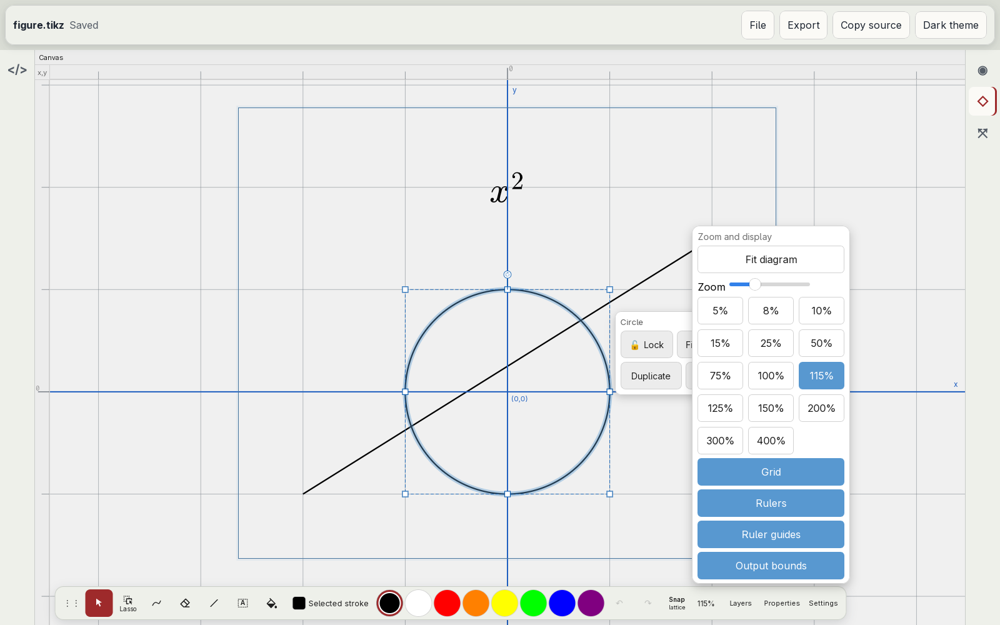
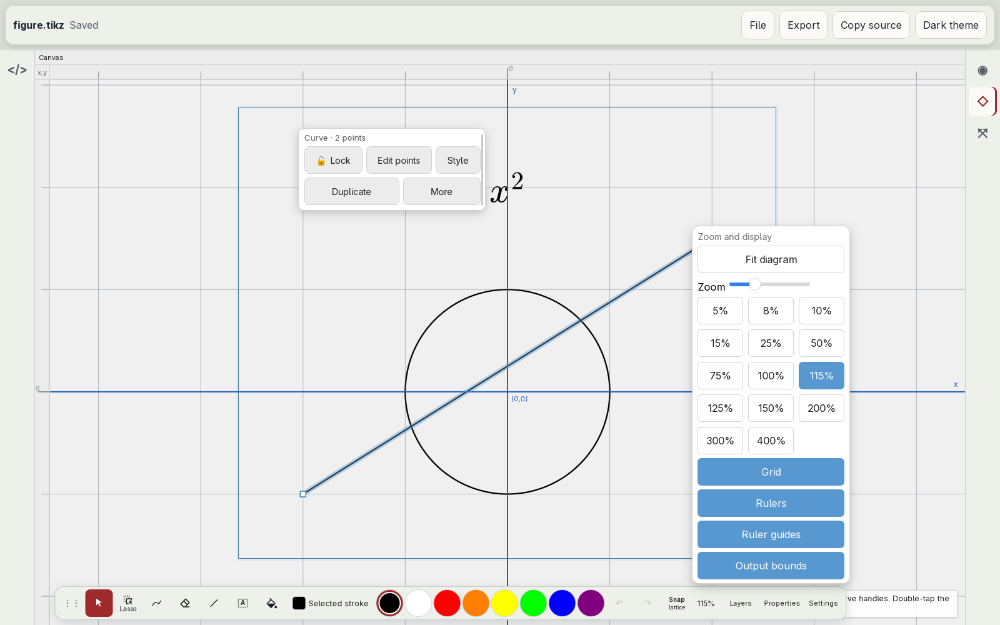
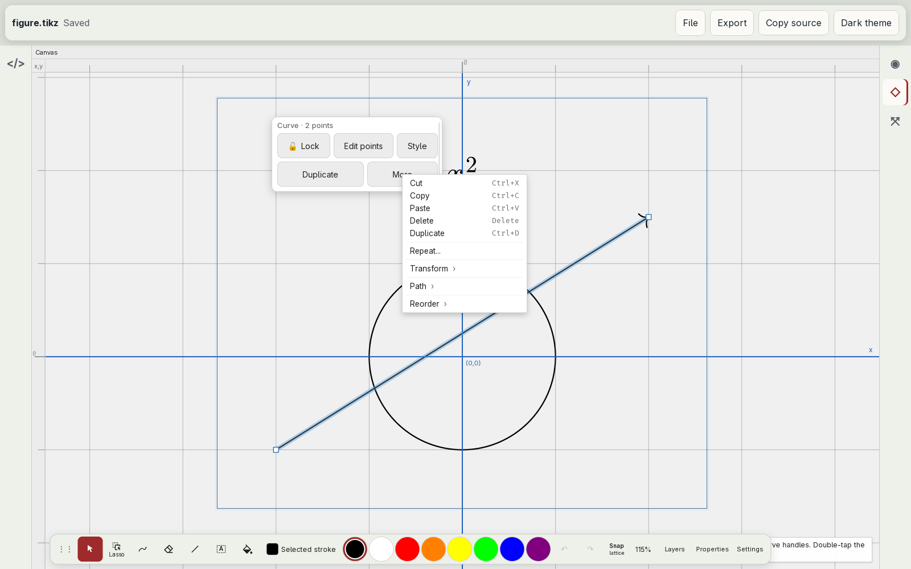
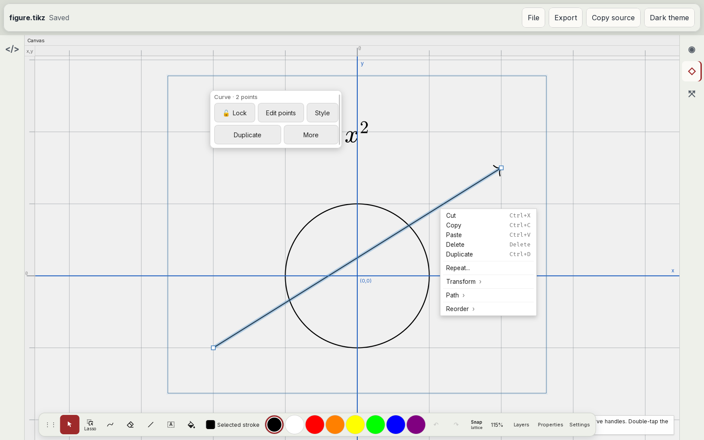
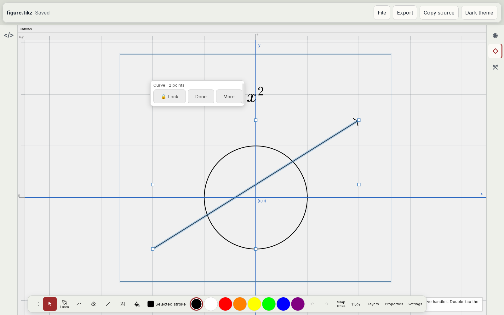
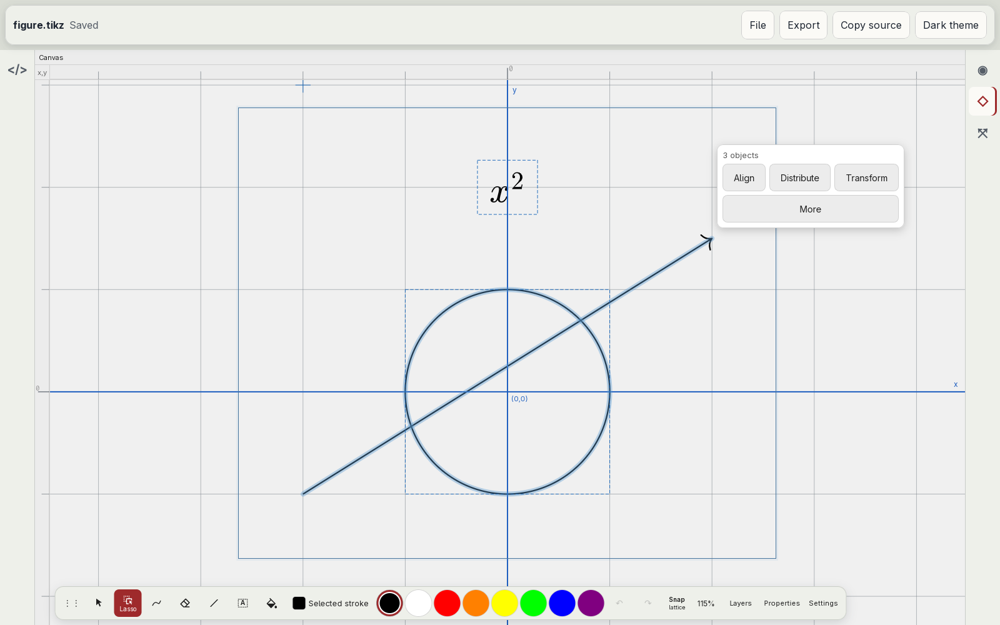
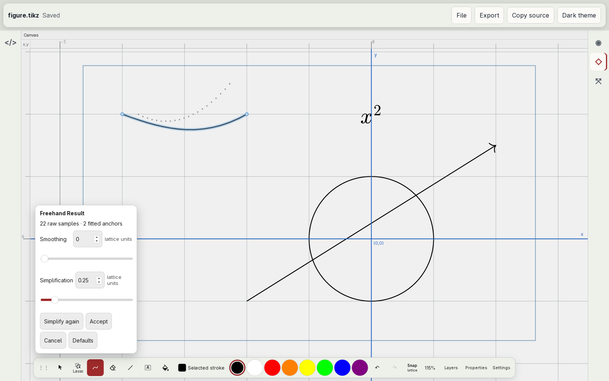
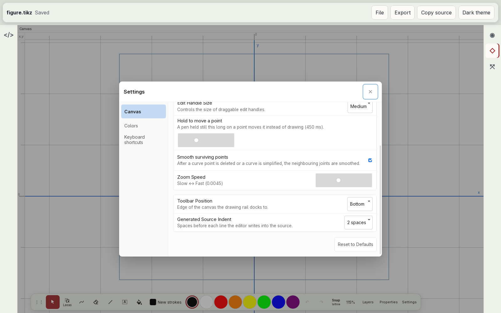
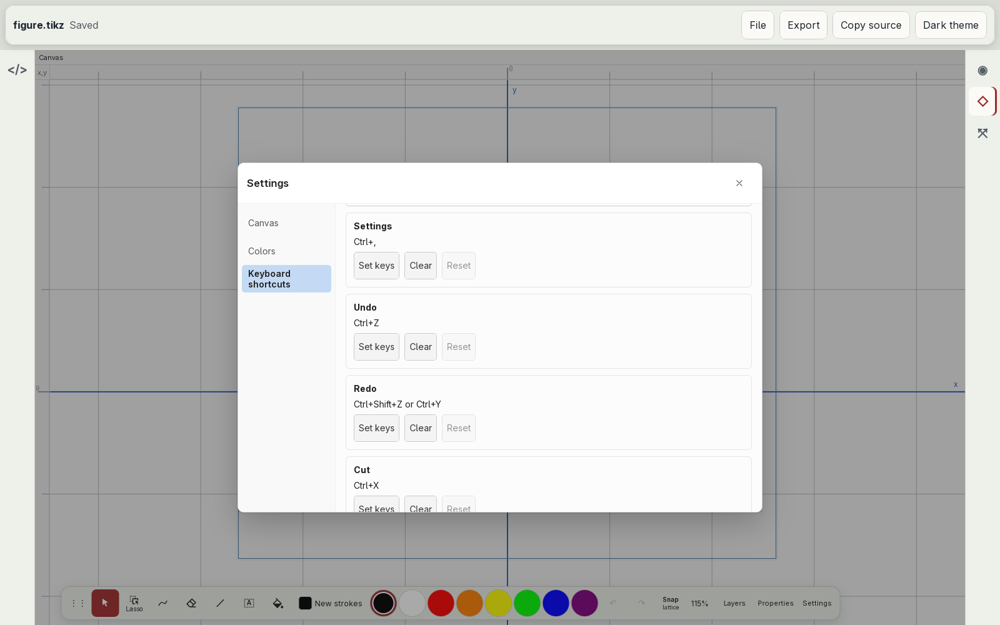

# Selection, refinement, and settings

Audit of the surfaces that act on a selection, on a new stroke, and on the editor's settings ([#24](https://github.com/dzackgarza/visual-tikz-editor/issues/24), part of [#17](https://github.com/dzackgarza/visual-tikz-editor/issues/17)): the selection strip, the context menu, the Freehand result popover, the Settings dialog, and the keyboard shortcut list. The specification at the end replaces every earlier rule about these surfaces. Where [the interaction model](../interaction-model.md) disagrees, this document holds; [#25](https://github.com/dzackgarza/visual-tikz-editor/issues/25) rewrites it.

## The surfaces today

Captured in the installed desktop app at 1600×1000 with a fresh profile and a figure of a circle, an arrow, and the node `$x^2$`.

| Surface | Screenshot |
| --- | --- |
| Circle selected |  |
| Arrow selected |  |
| More |  |
| Right-click |  |
| Edit points |  |
| Three objects |  |
| Freehand result |  |
| Settings, Canvas page |  |
| Keyboard shortcuts |  |
| Shortcut labels |  |

Source: fork `.cache/tikz-editor/packages/app/src/` unless a path says otherwise.

- **Selection strip.** A floating strip opens by itself for every selection made with Select or Lasso while no Freehand result is open (`ui/canvas-panel/CanvasPanel.tsx:4935-5169`, `ui/canvas-panel/SelectionStrip.tsx`). It shows a scope line ("Circle", "Curve · 2 points", "3 objects"), a Lock toggle drawn with the 🔒 and 🔓 emoji, text buttons for the kind of selection, and More. A shape gets "Fill and stroke", "Style", "Duplicate", and a Transform menu; a curve gets "Edit points", "Simplify", "Style", "Duplicate"; several objects get Align, Distribute, and Transform menus; a curve with an original stroke also gets "Restore original stroke" or "Reapply original fit". A straight two-point arrow is called "Curve". The strip has no close control and leaves only when the selection ends.
- **Edit points.** "Edit points" turns the strip into "Curve · 2 points" with Lock, Done, and More; with points selected it shows Smooth, Corner, Delete, and Split.
- **Placement.** The strip has its own placement routine (`ui/canvas-panel/selection-strip-place.ts`) that avoids other surfaces, and z-index 190 (`FreehandResultPopup.module.css:64`). For three objects it sat at the top right of the canvas, away from the selection. The zoom popover covered most of the circle's strip, and neither Escape nor a canvas press closed the popover. The Freehand result popover (z-index 200) and the Properties sheet (`ui/DockLayout.tsx:694-718`) place themselves separately again.
- **More and the context menu.** More opens the context menu of the selection. Right-click opens the same menu: Cut, Copy, Paste, Delete, Duplicate with their shortcuts, Repeat…, and the submenus Transform, Path, and Reorder (`ui/CanvasContextMenu.tsx`, `context-menu/canvas-context-menu.ts`).- **Opening the context menu.** The menu opens only on the browser's `contextmenu` event (`ui/canvas-panel/CanvasPanelView.tsx:436,469,516,594`, `ui/canvas-panel/overlays.tsx:853-1321`). The editor adds no long press. A pen held still on a point for 450 ms starts a move of that point (`pointMoveHoldMs`, `ui/SettingsModal.tsx:181-185`), so a long press on a point is already bound.
- **Freehand result.** Every stroke drawn as geometry is written into the source as drawn, and a popover opens with a fitted curve as a preview (`ui/canvas-panel/CanvasPanel.tsx:2665-2680`, `5384-5413`). The popover shows "22 raw samples · 2 fitted anchors", Smoothing (0 to 1) and Simplification sliders both labelled "lattice units", and Simplify again, Accept, Cancel, Restore original, and Defaults. Defaults discloses a "New strokes" group: "Refine new strokes automatically", "Keep the original in source", "Use for new strokes", "Save as default". The next stroke, Escape, or a tool change closes the popover and drops the preview (`CanvasPanel.tsx:2686`). The default is to ask after every stroke (`freehandAutoApply: false`, `settings/types.ts:126`).
- **Fit and lattice.** With lattice lock on, the default (`settings/types.ts:129`), the preview moved the ends of a stroke that rose to the right onto the nearest lattice points, 0.25 cm and 0.57 cm away, and drew a symmetric dip between them (Freehand result screenshot: dots are the samples, the line is the preview). No existing point was near either end. The interaction model attaches a stroke end only to an existing point (`docs/interaction-model.md`, Drawing row and Attachments); the code attaches ends through `pointTargetAt` (`ui/canvas-panel/CanvasPanel.tsx:2576-2588`), and the lattice move came from the start and end samples, which the canvas snapped to the lattice before the fit. The samples now follow the pen, as the samples of Inkscape's pencil do for pressure input (`src/ui/tools/pencil-tool.cpp`).
- **Settings.** The dialog has three pages: Canvas, Colors, and Keyboard shortcuts. The Canvas page shows six of the nineteen canvas settings (grid size, grid opacity, handle size, zoom speed, point-move hold time, smoothing after point deletion), then Toolbar Position and Generated Source Indent. Its "Reset to Defaults" button resets all nineteen canvas settings, among them lattice lock, both snapping rules, grid, rulers, guides, and the five Freehand settings, and also the toolbar position and indent (`ui/SettingsModal.tsx:45-53`, `settings/types.ts:124-144`). It asks no confirmation. The Colors page has its own reset for the palette.
- **Shortcut list.** One card per command with its shortcut or "Unassigned" and the buttons Set keys, Clear, and Reset (`ui/KeyboardShortcutsSettings.tsx`); four cards fit on the page at this size. Labels come from menu items without their menu: "Left", "Top", "Middle", "Bottom" from Align, two rows "Grid" for Insert Grid and Toggle Grid (`app-menu/default-menu.ts:434,488`), "Flatten foreach" (`settings/keybindings.ts:23-64`). Insert Equation and Edit Equation both default to Ctrl+Shift+E (`app-menu/default-menu.ts:459`, `context-menu/canvas-context-menu.ts:174`, `settings/keybindings.ts:41,62`). Recording a shortcut that another command has is refused: "Ctrl+… is already assigned to …. Clear or change that shortcut first." (`KeyboardShortcutsSettings.tsx:27-28`).
- **Shared styling.** The strip borrows the Freehand popover's stylesheet (`SelectionStrip.tsx:5`); `SelectionStrip.tsx`, `FreehandResultPopup.module.css`, and `settings/keybindings.ts` exist only in the fork, not upstream at `be197d85`.

## Prior art

### Captured on this host

| Application | Evidence | What the audit takes from it |
| --- | --- | --- |
| Inkscape 1.4.4 | [rectangle selected](images/inkscape-selected.png) | A selection opens no floating surface. The tool controls bar shows the selection's X, Y, W, H, rotation, flip, and stacking; the status bar names it: "Rectangle in layer Layer 1. Click selection again to toggle scale/rotation handles." |
| Inkscape 1.4.4 | [context menu](images/inkscape-context-menu.png) | Right-click opens one menu of commands with icons, labels, shortcuts, and separators: Cut, Copy, Paste, Paste… ›; Duplicate, Clone, Delete; Layers and Objects…, Object Properties…, Fill and Stroke…; Select Same ›; Move to Layer…, Create Anchor, Group; Set Clip Group; Hide Selected Objects, Lock Selected Objects. Style is a panel the menu opens, not a menu of its own. Lock is a menu command on the object, undone from the Objects panel. |
| Inkscape 1.4.4 | `/usr/share/inkscape/ui/toolbar-pencil.ui`, `toolbar-node.ui`; strings in `libinkscape_base.so` | The Pencil tool sets "Smoothing:" in its tool controls before drawing ("How much smoothing (simplifying) is applied to the line"); no surface opens after a stroke. Simplify is a command on a selected path ("Simplify selected paths (remove extra nodes)", Ctrl+L), with "Simplification threshold:" in Preferences. The node tool's controls bar carries the node commands: "Make selected nodes corner", "Make selected nodes smooth", "Delete selected nodes", "Break path at selected nodes". |
| Inkscape 1.4.4 | [Preferences, System page](images/inkscape-preferences-reset.png) | Preferences is one dialog with a page tree (Tools, Interface, Behavior, Input/Output, System, …). Its only reset is "Reset Preferences" on the System page, beside the path of the preferences file it resets; no page has a reset button for itself. |

### Documented behaviour

| Question | Convention | Sources |
| --- | --- | --- |
| Pinning one object for editing | "Isolation mode isolates objects so that you can easily select and edit particular objects or parts of objects." It "automatically locks all other objects"; "the isolated object appears in full color, while the rest of the artwork appears dimmed." Enter: "Double-click the path or group using the Selection tool." Exit: "Press Esc", or "Using the Selection tool, double-click outside of the isolated group." | Adobe Illustrator CS4 Help, "Isolation mode", pp. 205–207 ([manualsdir copy](https://www.manualsdir.com/manuals/753918/adobe-illustrator-cs4.html?page=205)) |
| Menu after a selection | Only GoodNotes opens a menu by itself: "as soon as you've finished lassoing content, the Object Menu appears immediately". Notability: "Click/tap inside the drawn circle, and a menu will appear." Apple Notes: "Tap the selection, then choose an option." Procreate shows a Selection toolbar at the bottom of the screen, not at the selection. Dismissal is a press outside: "Select outside the selection to apply the change." | [GoodNotes interface](https://support.goodnotes.com/hc/en-us/articles/13682253498767-Improved-User-Interface), [GoodNotes Object Menu](https://support.goodnotes.com/hc/en-us/articles/7353695644175), [Notability grouping](https://support.gingerlabs.com/en-us/articles/16300053-group-content-and-make-custom-stickers), [iPad Notes drawing](https://support.apple.com/guide/ipad/add-drawings-and-handwriting-ipada87a6078/ipados), [Procreate selections](https://help.procreate.com/procreate/handbook/selections/selections-interface) |
| One menu per item | "Provide either a context menu or an edit menu for an item, but not both." The iPadOS edit menu "appears when people touch and hold or double-tap to select content", and "People can tap a chevron on the trailing edge to expand it into a context menu." | [HIG Context menus](https://developer.apple.com/design/human-interface-guidelines/context-menus), [HIG Edit menus](https://developer.apple.com/design/human-interface-guidelines/edit-menus) |
| Opening a context menu | Mouse: right-click. Keyboard: Shift+F10 or the Menu key. Touch: long press. Pen: "tap the screen with the barrel button pressed, or long press on the content." | [Microsoft collection commanding](https://learn.microsoft.com/en-us/windows/apps/design/controls/collection-commanding), [HIG Pointing devices](https://developer.apple.com/design/human-interface-guidelines/pointing-devices), [GNOME HIG keyboard](https://developer.gnome.org/hig/guidelines/keyboard.html) |
| Placing and closing a menu | "the default menu position is above or below the insertion point or selection. The system also displays a visual indicator that points to the targeted content." "People expect to exit a menu by: Selecting an option; Tapping Escape or outside of the menu". | HIG Edit menus; [Material 3 menus, accessibility](https://m3.material.io/components/menus/accessibility) |
| Menu labels | "Use verbs or short verb phrases that succinctly describe the action your command performs." | HIG Edit menus |
| Lock | A command on the selected object: Freeform "tap Lock" in the formatting tools; Notability "On the menu that appears, tap Lock"; Inkscape "Lock Selected Objects". | [Freeform positioning](https://support.apple.com/guide/ipad/position-items-on-a-board-ipad0b4f22b0/ipados), [Notability shapes](https://support.gingerlabs.com/en-us/articles/16300159-creating-and-styling-perfect-shapes) |
| After a stroke | No inspected app opens a surface with settings after a stroke. A shape is recognised only when the stroke ends in a hold: GoodNotes "Draw the shape in one stroke and hold at the end"; Notability "hold the stroke until the ink snaps into place"; Apple Markup "then pause. A perfect version of the shape snaps into place … (If you prefer to keep the freehand shape, tap [undo].)"; Procreate shows one transient Edit Shape button: "continue painting, or tap anywhere to dismiss the button." | [GoodNotes shapes](https://support.goodnotes.com/hc/en-us/articles/13682939148943), Notability shapes, [iPad Markup](https://support.apple.com/guide/ipad/add-text-shapes-stickers-and-more-ipad8869ac3a/ipados), [Procreate QuickShape](https://help.procreate.com/procreate/handbook/guides/quickshape) |
| Reset scope | Per setting: VS Code "reset a setting to the default value by … selecting the Reset Setting action"; GNOME shows "Reset Shortcut" on a row only when that shortcut is not its default. Everything: one labelled action, confirmed in GNOME ("Reset All Shortcuts?", "All changes to keyboard shortcuts will be lost", Cancel, Reset All); Inkscape's "Reset Preferences" deletes the whole preferences file. No inspected source resets the visible page. | [VS Code settings](https://code.visualstudio.com/docs/configure/settings); GNOME Settings `panels/keyboard/cc-keyboard-shortcut-row.blp`, `cc-keyboard-shortcut-page.blp` at [`b767c5e`](https://gitlab.gnome.org/GNOME/gnome-control-center/-/blob/b767c5ec5250af7d92c94480bf1c60fcccc3b785/panels/keyboard/); Inkscape [`inkscape-preferences.cpp`](https://gitlab.com/inkscape/inkscape/-/blob/70feba21364ccbe2d2d2fab397228bc2e0d41b5a/src/ui/dialog/inkscape-preferences.cpp#L3884-3887), [`preferences.cpp`](https://gitlab.com/inkscape/inkscape/-/blob/70feba21364ccbe2d2d2fab397228bc2e0d41b5a/src/preferences.cpp#L260-287) |
| Shortcut conflicts | GNOME accepts the new keys and says what it removes: "This key combination is already being used for “%s”. This shortcut will be disabled."; only that key combination leaves the other action. VS Code accepts conflicts, counts them while recording ("1 existing command has this keybinding"), and lists them with "Show Same Keybindings". Neither refuses the keys. | GNOME `cc-keyboard-shortcut-editor.c` L284-297, L396-398 at `b767c5e`; [VS Code keybindings](https://code.visualstudio.com/docs/configure/keybindings), [`keybindingWidgets.ts`](https://github.com/microsoft/vscode/blob/c1263db0c58cde7cd15e9be2e53b255acd3f1629/src/vs/workbench/contrib/preferences/browser/keybindingWidgets.ts#L227-231) |
| Command names out of context | "The Command Palette, for instance, prefixes commands with their category, allowing for easy grouping." VS Code removes a binding from the row's context menu: "right-click on the entry in the Keyboard Shortcuts editor, and select Remove Keybinding." | [VS Code contribution points](https://code.visualstudio.com/api/references/contribution-points), VS Code keybindings |

## Departures

| Surface | Today | Convention | Departure |
| --- | --- | --- | --- |
| Selection strip | Opens by itself on every selection, has no close, sits anywhere on the canvas | A menu opened by a tap on the selection, right-click, or long press, placed at the selection; one app (GoodNotes) opens it by itself | Unrequested surface over the figure |
| Strip and context menu | Two surfaces, and More opens the second | One menu per item | Duplicate surface |
| Scope line | "Curve · 2 points" for a straight arrow | The status bar names the selection ("Rectangle in layer Layer 1") | Wrong name, in a floating surface |
| Strip Lock | Pins the selection: other objects cannot be selected until it is undone; emoji icon | "Lock" locks the object; pinning one object is isolation mode, entered by double-click, left by Escape | One word for two behaviours; unconventional control |
| Point commands | Strip buttons in Edit points, ended by Done | Commands of the node tool's controls; double-click enters node editing | Floating buttons and a Done step |
| Context menu trigger | Right-click only; a pen hold on a point moves it | Right-click, Shift+F10, long press, pen barrel button | No touch or pen route |
| Placement | Strip, Freehand popover, and Properties sheet place themselves separately; the zoom popover covers the strip and ignores Escape | Above or below the target, pointing at it; Escape or a press outside closes | Three placements; popover that does not close |
| Freehand result | A popover with counts, two sliders, five buttons, and a disclosure after every stroke | Smoothing set before drawing; Simplify a later command; shapes on a hold | Decision demanded after every stroke |
| Freehand fit | Ends moved to the nearest lattice points, 0.25 cm and 0.57 cm away; the rising stroke became a symmetric dip | The interaction model attaches a stroke end only to an existing point within reach | Repaired: the ends follow the pen |
| Settings reset | One button resets 21 settings, 13 of them not on the page, with no confirmation | Per-setting reset; one confirmed reset of everything | Silent reset of unseen settings |
| Shortcut list | Cards of three buttons per command; bare labels "Left", "Top", two rows "Grid" | One row per command, prefixed by its category; remove from a row menu | Repaired |
| Shortcut conflicts | Two default commands share Ctrl+Shift+E; a recorded conflict is refused | Accept and say what is removed (GNOME), or accept and show (VS Code) | Repaired |

## Specification

1. **One selection menu.** The selection strip is deleted. The commands of a selection are in one menu, the context menu. It opens on a right-click, Shift+F10 or the Menu key, a pen barrel-button tap, a long press on the selection, and a tap with pen or finger on an already selected object, as in Notability and Apple Notes. It never opens by itself. It sits above or below the selection with an arrow at it, and closes on a choice, Escape, or a press outside. A long press on an edit handle keeps its move behaviour (`pointMoveHoldMs`).
2. **Menu contents.** Items are verbs with icons, shortcuts, and separators, as in Inkscape, and only the commands that apply are listed: Cut, Copy, Paste, Duplicate, Delete; Edit Points, Simplify (Ctrl+L), Restore Original Stroke; Fill and Stroke…, which opens Properties ([#38](https://github.com/dzackgarza/visual-tikz-editor/issues/38)); Apply Style ›, Save Style…; Align ›, Distribute ›, Transform ›, Repeat…, Reorder ›; Group, Ungroup ([panels specification](panels.md) item 9); Lock. The strip's "Fill and stroke" and "Style" buttons are deleted with it.
3. **Selection name.** The status line ([#52](https://github.com/dzackgarza/visual-tikz-editor/issues/52)) names the selection by its kind and count: "Line", "Curve, 5 points", "Circle", "3 objects", "2 points selected". A two-point straight path is a "Line".
4. **Lock.** Lock locks the selected objects, as Inkscape's "Lock Selected Objects" and the lock in the Layers row ([#40](https://github.com/dzackgarza/visual-tikz-editor/issues/40)); a locked object cannot be selected on the canvas and is unlocked from Layers. The 🔒/🔓 toggle and the selection pin are deleted.
5. **Point editing.** A double-click or double-tap on a path, or Edit Points, enters point editing in isolation, as in Illustrator: the other objects are dimmed and locked until Escape or a double-tap outside the path. Smooth, Corner, Delete, and Split are the point commands of the context menu and of Properties while points are selected, as the node commands of Inkscape's node tool. "Done" is deleted.
6. **Freehand options before drawing.** The Freehand result popover is deleted. Smoothing and Simplification are Freehand tool options ([#27](https://github.com/dzackgarza/visual-tikz-editor/issues/27)), in cm ([#54](https://github.com/dzackgarza/visual-tikz-editor/issues/54)), together with "Keep original stroke"; they apply to every stroke as it is drawn, as Inkscape's Pencil "Smoothing:". Simplify is a command on a selected curve, Ctrl+L as in Inkscape (`app.path-simplify`, `/usr/share/inkscape/keys/inkscape.xml:363`), and each use simplifies further; Restore Original Stroke is a command on a curve whose original is kept. "Refine new strokes automatically", "Use for new strokes", "Save as default", and the sample counts are deleted.
7. **Shapes on a hold.** A stroke becomes a line, rectangle, circle, or ellipse only when it ends with the pen held still, as in GoodNotes, Notability, Apple Markup, and Procreate. Undo after the change returns the freehand stroke, as in Apple Markup. A stroke without a hold stays a curve.
8. **Popovers.** Every anchored popover (tool options, colour, zoom, context menu) uses one placement: above or below its anchor, pointing at it, inside the canvas. A choice, Escape, or a press outside closes it; one is open at a time ([dock specification](drawing-dock.md) item 8).
9. **Settings reset.** A changed setting shows a reset control on its row; an unchanged one shows none, as GNOME's "Reset Shortcut". The page button "Reset to Defaults" is deleted. One "Reset All Settings…" at the end of the page list asks "Reset all settings?", "All changes to settings will be lost", with Cancel and Reset All, as GNOME's "Reset All Shortcuts?". The Keyboard shortcuts page has its own "Reset All…" for shortcuts with the same confirmation.
10. **Shortcut list.** One row per command: its name prefixed by its menu ("Align: Left", "Insert: Grid", "View: Grid"), as VS Code prefixes a command with its category, then its shortcut or nothing. A search field filters by name and by key. A press on a row records; the row then shows "Press the new shortcut" ([instructional text](instructional-text.md) item 8). The row menu has Remove Shortcut and, when changed, Reset Shortcut. The per-row Set keys, Clear, and Reset buttons are deleted. The present build meets this rule.
11. **Shortcut conflicts.** No two default commands share a shortcut: Edit Equation has no default shortcut, and a double-click or double-tap on an equation opens its editor. Recording keys that another command has shows "Ctrl+Shift+E is used by Insert: Equation. It will be removed from there." and Enter assigns it and removes it from the other command only, as GNOME does. The refusal is deleted. The present build meets this rule.

## Implementation issues

An issue that names a dependency starts after that audit has its specification.

| Items | Issue | Depends on |
| --- | --- | --- |
| 1–3 | [#55](https://github.com/dzackgarza/visual-tikz-editor/issues/55) One selection menu: delete the selection strip; open the context menu by tap, long press, barrel button, and keyboard | #52, #59 |
| 4, 5 | [#56](https://github.com/dzackgarza/visual-tikz-editor/issues/56) Lock locks objects; point editing in isolation replaces the selection pin and Done | #55, #40 |
| 6 | [#57](https://github.com/dzackgarza/visual-tikz-editor/issues/57) Freehand options before drawing; delete the Freehand result popover | #27, #54 |
| 7 | [#58](https://github.com/dzackgarza/visual-tikz-editor/issues/58) Recognise a shape only when a stroke ends in a hold | #57 |
| 8 | [#59](https://github.com/dzackgarza/visual-tikz-editor/issues/59) One placement and closing rule for anchored popovers | — |
| 9 | [#60](https://github.com/dzackgarza/visual-tikz-editor/issues/60) Per-setting reset and one confirmed Reset All Settings | — |
| 3 | [#52](https://github.com/dzackgarza/visual-tikz-editor/issues/52) Status line (selection name) | — |
| 2 | [#43](https://github.com/dzackgarza/visual-tikz-editor/issues/43) Edit and Object menus (Group and Ungroup also in the selection menu) | #24 |
