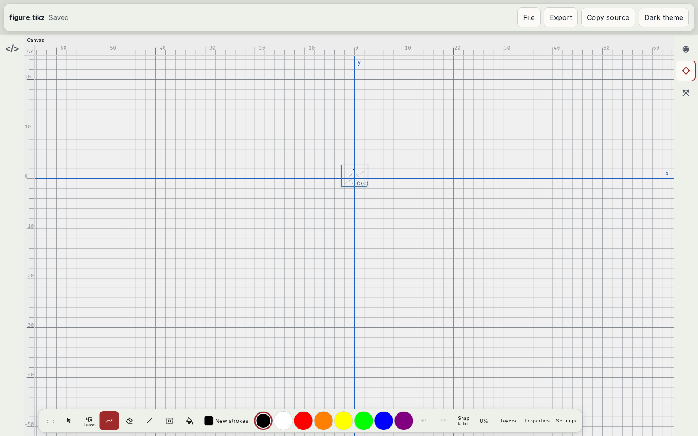
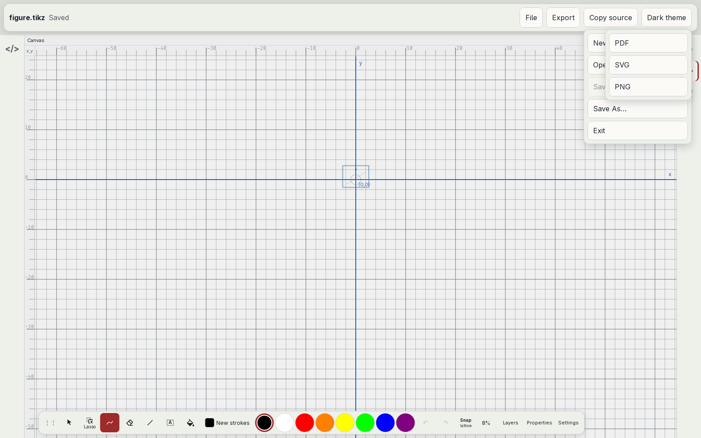
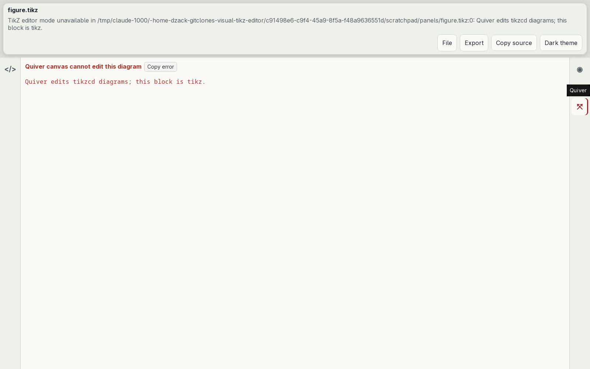
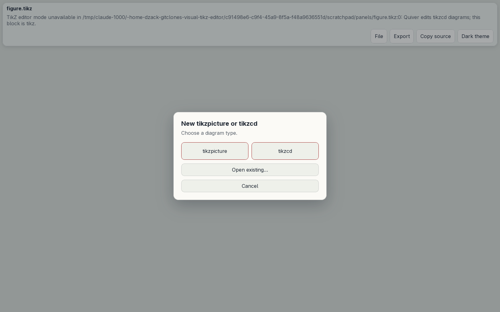

# Standalone shell

Audit of the standalone shell against established desktop document-editor conventions ([#22](https://github.com/dzackgarza/visual-tikz-editor/issues/22), part of [#17](https://github.com/dzackgarza/visual-tikz-editor/issues/17)). The shell is the document bar, its menus, the theme, the view rail, the window title, messages, and the dialogs around one document. The specification at the end replaces every earlier rule about these surfaces. Where [the interaction model](../interaction-model.md) disagrees, this document holds; [#25](https://github.com/dzackgarza/visual-tikz-editor/issues/25) rewrites the model and its stories. The status line belongs to [#21](https://github.com/dzackgarza/visual-tikz-editor/issues/21), zoom defaults to [#23](https://github.com/dzackgarza/visual-tikz-editor/issues/23), and settings to [#24](https://github.com/dzackgarza/visual-tikz-editor/issues/24).

## The shell today

Captured in the installed desktop app at 1600×1000 with a fresh profile and a figure of a circle, an arrow, and the node `$x^2$`.

| State | Screenshot |
| --- | --- |
| Document bar and Canvas view |  |
| File and Export menus both open |  |
| Quiver view for a tikzpicture |  |
| New dialog |  |

Source: `standalone/StandaloneApp.vue`, `standalone/server.ts`, `src/preview-modes.ts`, `src/ui/TikzWorkbench.vue`, and `src-tauri/src/main.rs` in this repository.

- **Document bar.** One row holds the file name, the status text, the view status, a File menu, an Export menu, a "Copy source" button, and a theme button (`StandaloneApp.vue:3-27`).
- **Menus.** File and Export are `
` elements. Both lists open at the right edge of the bar (`position: absolute; right: 12px`, `:680-692`), not under their titles. Both can be open at once and then overlap the view rail. Escape and a click outside leave a menu open; the click outside also reaches the canvas and draws a stroke. A menu closes only on a choice inside it (`:140-145`).
- **Menu items.** File: "New tikzpicture or tikzcd…", "Open…", "Save", "Save As…", and "Exit" (desktop only). Export: "PDF", "SVG", "PNG"; each opens a save dialog but has no ellipsis. No item shows a shortcut and no menu has separators (`:7-24`).
- **Shortcuts.** Ctrl+S saves; Ctrl+=, Ctrl+−, Ctrl+0 zoom the Canvas view. No other shell command has a shortcut (`:510-523`).
- **Theme.** A plain button reads "Dark theme" or "Light theme", the theme it switches to. The theme is a stored preference; the first paint reads a `localStorage` key that nothing writes, then the server preference replaces it (`:26,245-247,390,531-535`). The system appearance (`prefers-color-scheme`) has no effect.
- **Views.** The rail always offers Code, Preview, Canvas, and Quiver (`:131-137`), with the glyphs "</>", "◉", "◇", "⤧". Each view has a `supports` test (`preview-modes.ts:46-79`), but the rail ignores it: Quiver for a tikzpicture and Canvas for a tikzcd open a panel "… cannot edit this diagram" with "Copy error" (`TikzWorkbench.vue:70-75`). The rail names differ from the views' own labels "TeX render", "Quiver canvas", and "Drawing canvas".
- **Window title.** Fixed at "Visual TikZ Editor" (`main.rs:29-30`); no file name and no unsaved marker. The desktop window has no native menu bar.
- **Messages.** An error replaces the status text in the same grey (`:252-253,318-319`). The Quiver error above grows the status to three lines and moves every control in the bar; closing the view leaves the message. "Copy source" and Export give no confirmation (`:492-508,539-547`).
- **Save conflict.** When the file changed on disk, the server keeps the editor text as a recovery draft and answers 412 (`server.ts:178-184`). The status reads "The file changed on disk; recovery draft saved". A later Save sends the same revision (`StandaloneApp.vue:466-479`, `server.ts:179`) and shows the same status; only Save As, Open, or New leave the state. No choice compares or overwrites.
- **New and start-up.** File > New opens a modal dialog: "New tikzpicture or tikzcd", "Choose a diagram type.", "tikzpicture", "tikzcd", "Open existing…", and "Cancel" only when a document is open. Escape and a click on the backdrop leave it open. While it is open every view unmounts and the window behind it is empty (`:39-51`). A launch with no file opens this dialog (`:370`).
- **Save changes dialog.** "Save changes?" with Cancel, Discard, and Save; Escape cancels (`:28-38`). This matches the convention below.

## Prior art

### Captured on this host

| Application | Evidence | What the shell audit takes from it |
| --- | --- | --- |
| Inkscape 1.4.4 | [window](images/inkscape-1.4.4.png); `/usr/share/inkscape/ui/menus.ui`; `/usr/share/inkscape/keys/inkscape.xml`; `xprop` title on a private display | A menu bar File, Edit, View, Layer, Object, Path, Text, Filters, Extensions, Help. File: New, New from Template…, Open…, Open Recent, Save, Save As…, Save a Copy…, Revert, Import…, Export…, Print…, Document Properties…, Close, Quit. Edit starts Undo, Redo, Undo History…, Cut, Copy, Paste. Shortcuts: New Ctrl+N, Open Ctrl+O, Save Ctrl+S, Save As Ctrl+Shift+S, Close Ctrl+W, Quit Ctrl+Q, Undo Ctrl+Z, Redo Ctrl+Shift+Z and Ctrl+Y, Document Properties Ctrl+Shift+D, Group Ctrl+G, Ungroup Ctrl+Shift+G, Preferences Ctrl+Shift+P. Window title "ref.svg - Inkscape", and "\*ref.svg - Inkscape" after one edit. |
| Ipe 7.2.30 | [window](images/ipe-7.2.30.png); `xprop` title | A menu bar; Document properties is in the Edit menu. A launch with no file opens an untitled document titled "Ipe [unsaved]", and "Ipe \*[unsaved]" after one edit. |
| Xournal++ 1.3.8 | [window](images/xournalpp-1.3.8.png); `xprop` title | A menu bar. A launch with no file opens an untitled document titled "Unsaved Document - Xournal++". Edit > Preferences has "Theme Variant", default "Use system default" (survey section 8). |

### Documented behaviour

| Question | Convention | Sources |
| --- | --- | --- |
| Where a menu opens | Under the element that opened it: "the menus that pull down from the menubars commonly found at the top of many desktop application windows"; a pull-down button shows its menu from the button; GTK places the popup below the button | [APG Menu and Menubar](https://www.w3.org/WAI/ARIA/apg/patterns/menubar/); [HIG Pull-down buttons](https://developer.apple.com/design/human-interface-guidelines/pull-down-buttons); survey section 9 |
| Closing a menu | "Escape: Close the menu that contains focus and return focus to the element or context" that opened it; Enter on an item "activates the item and closes the menu"; "After people choose an item in a pull-down button's menu, the menu closes"; a popover closes on a tap outside it, one at a time | APG Menu and Menubar; HIG Pull-down buttons; survey section 2 |
| Opening a menu from the keyboard | Enter, Space, or Down Arrow "opens the menu and places focus on the first menu item" | [APG Menu button](https://www.w3.org/WAI/ARIA/apg/patterns/menu-button/) |
| Menu groups | "To help people visually distinguish such groups, use a separator" | [HIG Menus](https://developer.apple.com/design/human-interface-guidelines/menus) |
| Ellipsis | "Append an ellipsis to a menu item's label when the action requires more information before it can complete" | HIG Menus |
| File menu contents | New, Open, Open Recent ("don't display file paths"), Close, Save, then export; Export belongs in the File menu | [HIG The menu bar](https://developer.apple.com/design/human-interface-guidelines/the-menu-bar); Inkscape menus |
| Edit menu contents | "The Edit menu lets people make changes to content in the current document … and provides commands for interacting with the Clipboard"; it starts Undo, Redo | HIG The menu bar; Inkscape menus |
| View menu | "The View menu lets people customize the appearance of all an app's windows"; "Provide a View menu even if your app supports only a subset of the standard view functions" | HIG The menu bar |
| Quit | "Quit YourAppName" in the app menu (macOS); "\_Quit", Ctrl+Q (Inkscape) | HIG The menu bar; Inkscape menus |
| Help and About | GNOME primary menus end with Preferences, Keyboard Shortcuts, Help, and About; "Every primary menu should include" About | [GNOME HIG Menus](https://developer.gnome.org/hig/patterns/controls/menus.html) |
| Figure settings | A Document Properties dialog: Inkscape File > Document Properties… (Ctrl+Shift+D); Ipe Edit > Document properties | Inkscape and Ipe menus |
| Theme | "Avoid offering an app-specific appearance setting … they may think your app is broken because it doesn't respond to their systemwide appearance choice"; no checked app puts a theme button in a toolbar; overrides sit in Preferences with the system as default (Xournal++, Notability, OneNote) | [HIG Dark Mode](https://developer.apple.com/design/human-interface-guidelines/dark-mode); survey section 8 |
| Views valid for the document | VS Code shows "Open Preview to the Side" only when `editorLangId` is Markdown (`markdown.showPreviewToSide`, `when: editorLangId =~ /^(markdown\|…)$/`) | [`extensions/markdown-language-features/package.json`](https://github.com/microsoft/vscode/blob/main/extensions/markdown-language-features/package.json) |
| Window title | File name, app name, and an unsaved marker: "\*ref.svg - Inkscape", "Ipe \*[unsaved]" | Captures |
| Start-up without a file | An untitled document of the default kind, with no chooser | Ipe and Xournal++ captures |
| Ongoing conditions | Banners "communicate persistent states" as "a strip along the top of a view" with one title and an optional button; examples "Working offline" and a read-only document | [GNOME HIG Banners](https://developer.gnome.org/hig/patterns/feedback/banners.html) |
| Single events | Toasts show "messages and actions in the context of using an app", are "always transient and user dismissible", and suit single occurrences | [GNOME HIG Toasts](https://developer.gnome.org/hig/patterns/feedback/toasts.html) |
| Save conflict | "Failed to save '{0}': The content of the file is newer. Please compare your version with the file contents or overwrite the content of the file with your changes.", with the actions Compare and Overwrite. A later Save sends the etag of the last read or write again (`lastResolvedFileStat.etag`; a failed save does not change it) and fails the same way; Overwrite saves with `ignoreModifiedSince` | VS Code [`textFileSaveErrorHandler.ts`](https://github.com/microsoft/vscode/blob/main/src/vs/workbench/contrib/files/browser/editors/textFileSaveErrorHandler.ts), [`textFileEditorModel.ts`](https://github.com/microsoft/vscode/blob/main/src/vs/workbench/services/textfile/common/textFileEditorModel.ts) |
| Modal dialogs | "Escape: Closes the dialog"; focus returns to the element that opened it | [APG Dialog (Modal)](https://www.w3.org/WAI/ARIA/apg/patterns/dialog-modal/) |

Not verified from a primary source: how long a GNOME toast stays; the GNOME window title for a modified document; how GoodNotes and Notability title or close menus.

## Departures

| Control | Today | Convention | Departure |
| --- | --- | --- | --- |
| Menu placement | Both lists at the right edge of the bar | Under the menu title | Detached menus |
| Menu closing | Only a choice closes a menu; two can be open | Escape, a choice, a click outside, or another menu closes it; one at a time | No dismissal |
| Click outside an open menu | Reaches the canvas and draws | Closes the menu only | Click passes through |
| Menu set | File and Export menus, a Copy source button | File, Edit, View, Object, Help; Export and Copy inside menus | Commands spread across bar controls |
| Shortcut labels and separators | None | Shortcuts shown on items; groups separated | Missing |
| Ellipsis | "PDF", "SVG", "PNG" open a dialog without "…" | Ellipsis when more input follows | Missing ellipsis |
| "Exit" | "Exit", no shortcut | "Quit", Ctrl+Q | Name and shortcut |
| Shortcuts | Save and zoom only | New, Open, Save As, Close, Quit, Undo, Redo, Document Properties, Group | Missing |
| Theme | Toolbar button, stored preference, system ignored | Follow the system | Repaired |
| Views offered | All four, always | Only views valid for the document | Error panels on demand |
| View names | Rail and view labels differ; glyphs | One name per view | Two names |
| Window title | "Visual TikZ Editor" | File name, app name, unsaved marker | Repaired |
| Error display | Replaces status, wraps to three lines, moves the bar | Banner for a state, toast for an event | Layout shift; no distinction |
| Confirmation | None for Copy source and Export | Toast | Silent |
| Save conflict | Status text; Save keeps failing | Compare or Overwrite | No resolution; repeated failure |
| New | Modal kind chooser, workspace unmounted | New per kind in the menu | Repaired |
| Start-up without a file | Kind chooser | Untitled document of the default kind | Repaired |
| Dialog dismissal | New dialog ignores Escape | Escape closes; focus returns | Repaired |

## Specification

1. **Menu bar.** The document bar holds a menu bar: File, Edit, View, Object, Help. It is one implementation in the desktop and browser builds and follows the WAI-ARIA menubar pattern. A menu opens directly under its title. One menu is open at a time; hovering another title while a menu is open moves to that menu. A choice, Escape, a second press on the title, or a press outside closes the menu; a press outside does nothing else. Escape returns focus to the title. Items show their shortcut at the trailing end, groups are separated, and an item that asks for more input ends in "…". The Export menu and the Copy source button leave the bar.
2. **File menu.** New tikzpicture (Ctrl+N), New tikzcd; Open… (Ctrl+O), Open Recent (file names, not paths); Save (Ctrl+S), Save As… (Ctrl+Shift+S), Export (PDF…, SVG…, PNG…); Document Properties… (Ctrl+Shift+D); Quit (Ctrl+Q, desktop only).
3. **Edit menu.** Undo (Ctrl+Z), Redo (Ctrl+Shift+Z, Ctrl+Y); Cut, Copy, Paste, Delete, Select All; Copy TikZ Source; Settings… (Ctrl+Shift+P), as Inkscape's Edit › Preferences… (`/usr/share/inkscape/ui/menus.ui:354-357`, `/usr/share/inkscape/keys/inkscape.xml:82`) and Xournal++'s Edit › Preferences. Each editing command goes to the focused view: the Code view, the Canvas, or Quiver.
4. **View menu.** The views the document supports, as check items; Properties and Layers, as check items ([panels specification](panels.md) item 1); the zoom commands and canvas aids of the [zoom specification](zoom-and-view.md) item 5.
5. **Object menu.** Group (Ctrl+G), Ungroup (Ctrl+Shift+G); Bring to Front, Bring Forward, Send Backward, Send to Back. These are the commands that leave the Layers header ([panels specification](panels.md) item 9).
6. **Help menu.** Keyboard Shortcuts, which lists every shortcut above; About Visual TikZ Editor.
7. **Views by document.** The rail and the View menu offer only the views whose `supports` test holds for the document: Quiver for a tikzcd, Canvas for a tikzpicture, Code and Preview for both. Each view has one name in the rail, the View menu, and the view itself: Code, Preview, Canvas, Quiver. Rail buttons use icons from the icon set the canvas already uses, with the name as tooltip and accessible label.
8. **Theme.** The interface follows the system appearance (`prefers-color-scheme`) and changes when the system changes. No control in the app sets the theme, and no preference stores it. The present build meets this rule.
9. **Window title.** "figure.tikz - Visual TikZ Editor", with a leading "\*" while there are unsaved changes, as in Inkscape. The browser build sets the page title the same way. An untitled document is titled by its file name, "Untitled.tikz - Visual TikZ Editor". The present build meets this rule.
10. **Messages.** The document bar is one row of fixed height; no message changes its height or moves its controls. A persistent state (the file changed on disk, the renderer is unavailable) shows as a banner at the top of the workspace with one title and at most one button, and leaves when the state ends. A single event shows as a toast: "Copied TikZ source", "Exported figure.pdf", or the failed command and its reason. Where the status text sits belongs to #21.
11. **Save conflict.** When the file changed on disk, a banner reads "figure.tikz changed on disk" with the actions Compare and Overwrite, as in VS Code. Compare shows the disk text against the editor text; Overwrite writes the editor text over the file. A Save after the conflict shows the same banner and leaves the file unchanged until Compare or Overwrite ends the conflict, as in VS Code; the present build already does this (WF 290).
12. **New and start-up.** File > New tikzpicture and New tikzcd create the document directly. A launch with no file opens an untitled tikzpicture, as Ipe and Xournal++ open an untitled document. Every dialog (Save changes, Document Properties) closes on Escape, returns focus to the control that opened it, and leaves the workspace mounted behind it; for a menu item, that control is the menu title. The present build meets this rule; Document Properties (#50) is not built yet.

## Implementation issues

An issue that names a dependency starts after that audit has its specification.

| Items | Issue | Depends on |
| --- | --- | --- |
| 1, 2, 6 | [#42](https://github.com/dzackgarza/visual-tikz-editor/issues/42) Menu bar with File and Help menus | — |
| 3, 5 | [#43](https://github.com/dzackgarza/visual-tikz-editor/issues/43) Edit and Object menus send commands to the focused view | #24, #39 |
| 4, 7 | [#44](https://github.com/dzackgarza/visual-tikz-editor/issues/44) View menu; views offered by document kind; one name per view | #23 |
| 10 | [#47](https://github.com/dzackgarza/visual-tikz-editor/issues/47) Fixed-height document bar; banners and toasts | #21 |
| 11 | [#48](https://github.com/dzackgarza/visual-tikz-editor/issues/48) Save conflict: Compare and Overwrite | — |
| 2 | [#50](https://github.com/dzackgarza/visual-tikz-editor/issues/50) Document Properties dialog | — |
