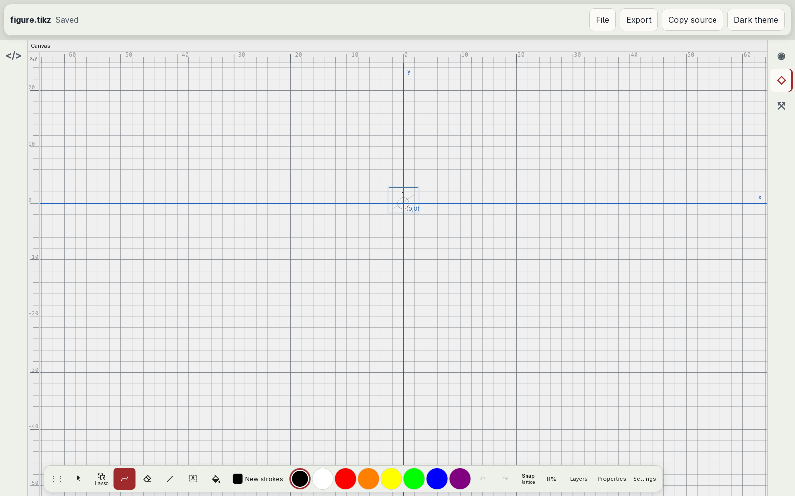
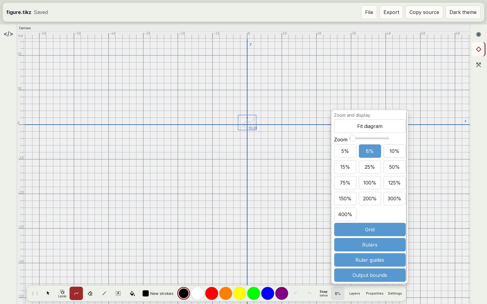
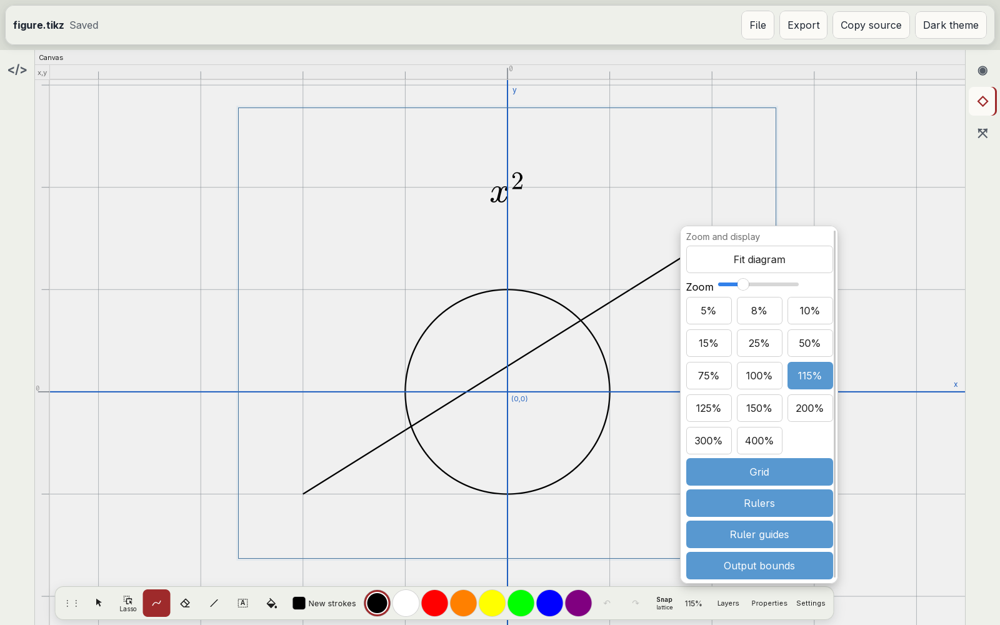
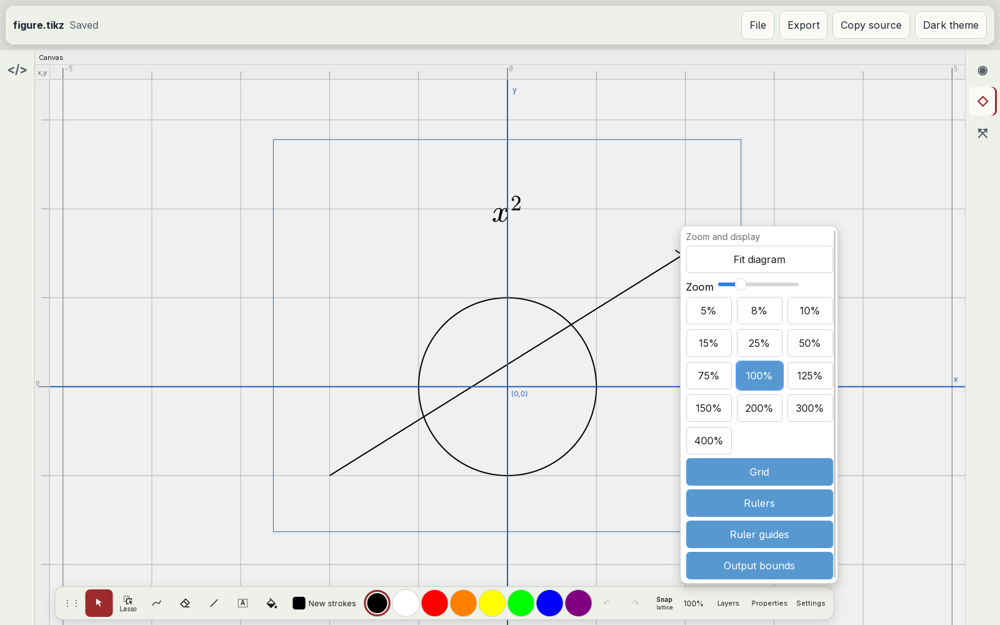

# Zoom and view

Audit of the canvas zoom and its view defaults ([#23](https://github.com/dzackgarza/visual-tikz-editor/issues/23), part of [#17](https://github.com/dzackgarza/visual-tikz-editor/issues/17)): the view a figure opens with, the meaning of a zoom percentage, the zoom control, and the rulers. The specification at the end replaces every earlier rule about these surfaces. Where [the interaction model](../interaction-model.md) disagrees, this document holds; [#25](https://github.com/dzackgarza/visual-tikz-editor/issues/25) rewrites it.

## The view today

Captured in the installed desktop app at 1600×1000 with a fresh profile and a figure of a circle of radius 1 cm, an arrow, and the node `$x^2$`.

| State | Screenshot |
| --- | --- |
| At launch |  |
| Zoom popover |  |
| After Fit diagram |  |
| At 100 % |  |

Source: fork `.cache/tikz-editor/packages/app/src/` unless a path says otherwise.

- **Launch view.** The first view of a figure centres the origin and picks the largest preset that fits a 40 cm square around it (`ui/canvas-panel/useCanvasViewportPersistence.ts:143-163`, called at `:286`). The figure's own size plays no part, so a figure of a few centimetres opens as a speck. The scale is chosen once, for the canvas size at that moment: two fresh launches that ended at 1600×1000 opened at 8 % (window resized 20 s after start) and 10 % (window resized as it appeared). Upstream tikz-editor at `be197d85` opens a figure fitted to its content, with fit-to-content mode on (same file, `:179-185`).
- **Return to a figure.** The last view of each figure is kept in memory for the session (`useCanvasViewportPersistence.ts:94,208,268-277`). Nothing is saved, so every launch shows the launch view again.
- **Meaning of 100 %.** The readout divides the scale by `CANVAS_ZOOM_BASE_SCALE = 5` px per TeX point (`store/workspace-state.ts:18`, `ui/ZoomDisplayControl.tsx:21`). Printed size at the CSS reference of 96 px per inch is 96/72.27 ≈ 1.33 px per point, so the fork's 100 % is 3.76 times printed size: the 1 cm circle has a radius of 142 px, where printed size is 37.8 px. The launch view at 8 % is 30 % of printed size; Fit diagram at 115 % is 4.3 times. Upstream defines 100 % as printed size (`ACTUAL_SIZE_SCALE = CSS_SCREEN_DPI / TEX_PT_PER_IN`, `ui/StatusBar.tsx:12` at `be197d85`); the fork keeps that constant in a status bar that its embed hides (`ui/App.tsx:1889`).
- **Zoom control.** The dock's percentage button opens "Zoom and display" (`ui/ZoomDisplayControl.tsx:37-48`): Fit diagram; a slider from 5 % to 400 %; one button per preset 5, 8, 10, 15, 25, 50, 75, 100, 125, 150, 200, 300, 400 % (`store/workspace-state.ts:20`), plus the current value when it is not a preset (115 % after Fit diagram); and the toggles Grid, Rulers, Ruler guides, Output bounds. A choice leaves the popover open. Escape did not close it; it switched the tool from Freehand to Select.
- **Commands and keys.** The View menu has Fit to Content, Zoom In (Ctrl+=), Zoom Out (Ctrl+−), then Grid, Rulers, Ruler Guides (`app-menu/default-menu.ts:463-500`). Ctrl+0 is Fit to Content (`settings/keybindings.ts:60`); there is no Actual Size command. Zoom In and Zoom Out multiply the scale by 1.15 (`useCanvasViewportPersistence.ts:359`); Ctrl+wheel and a two-finger pinch zoom about the pointer or the pinch centre (`ui/canvas-panel/useCanvasViewportEffects.ts:263-291`).
- **Rulers.** The corner reads "x,y" with the tooltip "Source lattice coordinates" (`ui/canvas-panel/CanvasPanelView.tsx:424`). Labels carry no unit. Their step does not follow the zoom: labels every 10 at 8 %, every 5 at 100 %, and at 115 % only "0" on each ruler, so the view has no readable coordinate.

## Prior art

### Captured on this host

| Application | Evidence | What the audit takes from it |
| --- | --- | --- |
| Inkscape 1.4.4 | [Zoom Page](images/inkscape-zoom-page.png), [Zoom 1:1](images/inkscape-zoom-1-1.png) | A document without a saved view opens zoomed to its page (`sp-namedview.cpp`, survey section 6); Zoom Page (key 5) is that view, here at 58 %. At "Zoom to 1:1" the status bar reads "Z: 100%" and 25 mm on the ruler is 94 px, printed size at 96 px per inch. The zoom readout is the "Z:" field at the right end of the status bar, after the pointer position "X: Y:" and before rotation "R:". Ruler labels are in the document unit and their step follows the zoom: every 50 mm at 58 %, every 25 mm at 100 %. |
| Inkscape 1.4.4 | [View › Zoom](images/inkscape-view-zoom.png), [View › Show/Hide](images/inkscape-view-show-hide.png), `/usr/share/inkscape/keys/inkscape.xml:186-197` | Zoom commands are a submenu of View: Zoom In (+), Zoom Out (−), Zoom to 1:1 (1), Zoom to 1:2 (2), Zoom to 2:1, Zoom Selection (3), Zoom Drawing (4), Zoom Page (5), Zoom Page Width (6), Center Page (Ctrl+4), Zoom Previous, Zoom Next. Page Grid and Guides are check items of View; Rulers (Ctrl+R) is a check item of View › Show/Hide. No zoom surface holds display toggles. |
| Xournal++ 1.3.8 | [new document](images/xournalpp-startup.png), [View menu](images/xournalpp-view.png) | A new document opens fitted to the page width (152 % here), at the top of the page. The footer's right end holds the zoom: Normal Size (the "1" button), Zoom to Fit, Zoom Out, a slider with the percentage, Zoom In. The View menu has Zoom In (Ctrl++), Zoom Out (Ctrl+−), Normal Size, and Zoom to Fit as a check item that stays on until the user zooms. |
| Ipe 7.2.30 | [new document](images/ipe-startup.png), [Zoom menu](images/ipe-zoom-menu.png) | A new document opens fitted to the page width at the top of the page (`action_fit_top`, survey section 6). The status bar shows the resolution ("119ppi"). The Zoom menu has Zoom In (Ctrl+PgUp), Zoom Out (Ctrl+PgDown), Normal Size, Fit Page, Fit Width, Fit Page Top, Fit Objects, Fit Selection, and the check item Grid Visible (F12). |
| tikz-editor (upstream) | `be197d85`: `ui/StatusBar.tsx`, `ui/canvas-panel/useCanvasViewportPersistence.ts:100-120,179-185` | A figure opens fitted to its content, centred. 100 % is printed size. The zoom percentage and a fit-to-content toggle are in the status bar under the canvas. |

### Documented behaviour

| Question | Convention | Sources |
| --- | --- | --- |
| Meaning of 100 % | Printed size. Inkscape: "Show zoom as a percentage, where 1:1 is 100%", and a "Zoom correction factor" set by matching an on-screen ruler to a real one "to display objects in their true sizes". Xournal++: 100 % is the display DPI over 72 points per inch, "To make sure on 100% zoom the size of elements is natural", with "Display DPI Calibration": "Put a ruler on your screen and move the slider until both rulers match." Ipe: "Normal size" is 72 pixels per inch, changeable in its preferences, shown as a resolution. | Inkscape `src/ui/widget/status-bar.cpp:74`, `src/ui/dialog/inkscape-preferences.cpp:1688-1694`, `src/desktop.cpp:744-757` at [`70feba2`](https://gitlab.com/inkscape/inkscape/-/tree/70feba21364ccbe2d2d2fab397228bc2e0d41b5a); Xournal++ `src/core/control/zoom/ZoomControl.cpp:269`, `ui/settings.glade:4535,4555` at [`4d6810b`](https://github.com/xournalpp/xournalpp/tree/4d6810b3760c7b3f90c6a3271d6a5623cfb5481f); Ipe `src/ipe/lua/prefs.lua:295-297` at [`f4a918b`](https://github.com/otfried/ipe/tree/f4a918b12e68f1f244dd3c7d0e30ecf78ea13a01) |
| View at open | The page, fitted. Inkscape restores the view saved in the file, else "document without saved zoom, zoom to its page". Xournal++ opens a new document in fit mode (fit to page width) and a saved file at the zoom kept in its per-file metadata. Ipe always opens at "Fit page top". | Inkscape `src/object/sp-namedview.cpp:623-632,678-685`; Xournal++ `src/core/control/Control.cpp:1849-1856,1959-1964`, `ZoomControl.cpp:290`; Ipe `src/ipe/lua/main.lua:605-606`, `actions.lua:1640-1647` |
| Fit as a mode | Xournal++ "Zoom to Fit" is a check item; the view stays fitted until the user zooms, and a touchpad pinch turns it off. | Xournal++ `ui/mainmenubar.xml:355-370`, `ActionProperties.h:433-445`, `ZoomControl.cpp:49-55` |
| Readout | At the bottom of the window, beside the pointer position. Inkscape: a "Zoom (also Ctrl+scroll)" field in the status bar, typed or stepped, whose menu holds Zoom Selection, Zoom Drawing, Zoom Page, Zoom Page Width, Center Page and the presets 10, 20, 50, 100, 200, 500, 1000 %. Ipe: "Ipe displays the current resolution at the bottom right (behind the mouse coordinates)." Freeform: "tap the current percentage in the bottom-left corner, then tap a percent." Concepts: "tap the zoom value in the Status Bar to open an editor". | Inkscape `share/ui/statusbar.ui:9-34,141-147`, `status-bar.cpp:52-60`; Ipe `manual/20_concepts.rst:278-279`; [Freeform on iPad](https://support.apple.com/guide/ipad/create-a-freeform-board-ipade453ddaa/ipados); [Concepts infinite canvas](https://concepts.app/en/manual/infinite-canvas) |
| Zoom commands | GNOME HIG: "Zoom In Ctrl++", "Zoom Out Ctrl+-", "Normal Size Ctrl+0 Resets the zoom level to the default." Xournal++ View: Zoom In, Zoom Out, Normal Size, Zoom to Fit. Ipe Zoom: Normal size, Fit page, Fit width, Fit objects, Fit selection. Freeform on Mac: "View > Zoom > Zoom to Selection", "View > Zoom > Zoom to Fit Content". | [GNOME HIG keyboard](https://developer.gnome.org/hig/reference/keyboard.html); Xournal++ `ui/mainmenubar.xml:355-370`; Ipe `src/ipe/appui.cpp:348-355`; [Freeform on Mac](https://support.apple.com/guide/freeform/frfm000074a4e/mac) |
| Pointer and touch | GNOME HIG: zoom is Ctrl+scroll wheel with a mouse and a pinch on a touchpad or touchscreen. Freeform: "zoom in or out by pinching open or closed." Apple HIG: "If you support zoom, set appropriate maximum and minimum scale values." | [GNOME HIG pointer and touch](https://developer.gnome.org/hig/reference/pointer-touch.html); Freeform on iPad; [HIG Scroll views](https://developer.apple.com/design/human-interface-guidelines/scroll-views) |
| Display toggles | Menu check items, not zoom controls. Inkscape View: "Page Grid", "Guides", and Show/Hide › "Rulers" (Ctrl+R). Ipe Zoom: "Grid visible" (F12). | Inkscape `share/ui/menus.ui:568-597`, `share/keys/inkscape.xml:228-235`; Ipe `src/ipe/appui.cpp:324` |
| Rulers | The document's display unit, with its name as the ruler tooltip; the label step follows the zoom. Inkscape's ruler corner is a guide-lock toggle. | Inkscape `src/ui/widget/desktop-widget.cpp:780-785`, `src/ui/widget/canvas-grid.cpp:88-106`, `src/ui/widget/ink-ruler.cpp:220-251`, `share/ui/units.xml:3-21` at [`70feba2`](https://gitlab.com/inkscape/inkscape/-/tree/70feba21364ccbe2d2d2fab397228bc2e0d41b5a); Inkscape captures above |
| Magnifier | A menu command shows and hides a loupe. macOS Preview: "Choose Tools > Show Magnifier, then move the pointer over the area you want to magnify." "To stop magnifying, choose Tools > Hide Magnifier or press the Esc key." | [Preview User Guide](https://support.apple.com/guide/preview/prvw11470) |

## Departures

| Surface | Today | Convention | Departure |
| --- | --- | --- | --- |
| Launch view | A 40 cm square around the origin at 5–15 %; a small figure is a speck; the scale depends on the window size at load | Fit the page or the page width (Inkscape, Xournal++, Ipe); fit the content (upstream) | The figure is not visible at launch |
| 100 % | 3.76 times printed size | Printed size at 96 px per inch (Inkscape, Xournal++ Normal Size, upstream) | Every percentage misreports the size |
| Zoom control | A dock button opening a popover of fifteen buttons, a slider, and four display toggles; the popover stays open and ignores Escape | A readout at the right end of the status bar; zoom commands in View; display toggles in View | Wrong place; display toggles under zoom |
| Normal size | No command; Ctrl+0 fits the content | Normal Size on Ctrl+0 (GNOME, Xournal++, Ipe), Zoom to 1:1 (Inkscape) | Missing command |
| Rulers | Centimetres; corner empty; label step by an uncited 1-2-5 × 10ⁿ, 50 px rule | Document unit; label step by Inkscape's ruler metric | Step rule has no source |

## Specification

1. **100 % is printed size.** At 100 % a length of the figure has its printed size at the CSS reference of 96 px per inch: 1 cm is 37.8 CSS px and 1 pt is 96/72.27 px, as upstream's `ACTUAL_SIZE_SCALE`, Inkscape's "Zoom to 1:1", and Xournal++'s "Normal Size". Every percentage the editor shows or accepts is relative to that scale; `CANVAS_ZOOM_BASE_SCALE` is deleted. Settings › Canvas has "Display calibration", a ruler of 10 cm drawn on screen and a slider that scales it until it matches a real ruler, as Inkscape's zoom correction factor and Xournal++'s Display DPI Calibration; 100 % includes the calibration. The zoom range stays the present scale range, 4 % to 1500 % of printed size, and widens to twice the Zoom to Fit scale when that is larger.
2. **Opening a figure.** A figure with content opens in Zoom to Fit: its drawing's bounding box, centred, with a margin of 44 px on each side, as upstream tikz-editor (`computeFitToContentScale`). The bounding box is the figure's output page (the `standalone` crop), so this is the view Inkscape, Xournal++, and Ipe open with: the page, fitted. An empty figure opens at 100 % with the origin centred. Zoom to Fit is a mode, as in Xournal++: while it is on, a change of the canvas size fits again, so the view does not depend on when the window got its size. A zoom, a pan, or a pinch turns it off.
3. **Returning to a figure.** Returning to a figure in the same session restores its last view, as today. The last view of each file is also kept in the editor's own state, keyed by the file's path, and restored when the file opens again, as Xournal++ keeps the zoom in its per-file metadata. The view is never written into the TikZ source.
4. **Zoom readout.** The zoom percentage sits at the right end of the status line ([#52](https://github.com/dzackgarza/visual-tikz-editor/issues/52)), after the pointer position, as Inkscape's "Z:" field and Ipe's resolution. It is a field: typing a number and Enter sets the zoom, as in Inkscape; a tap or click on its menu button opens Zoom to Fit, Zoom to Selection, Normal Size, then 10, 20, 50, 100, 200, 500, 1000 % as in Inkscape's zoom menu. The menu follows the [selection specification](selection-and-settings.md) item 8. The dock's zoom button and the "Zoom and display" popover with its slider and preset grid are deleted.
5. **View menu.** View has Zoom In (Ctrl+=), Zoom Out (Ctrl+−), Normal Size (Ctrl+0), Zoom to Fit as a check item, and Zoom to Selection, as GNOME's shortcuts and Xournal++'s and Ipe's menus; then the check items Grid, Rulers (Ctrl+R), Guides, and Output Bounds, as Inkscape's View menu. Show Magnifier is a check item: while it is on, a press and drag shows the loupe of upstream tikz-editor (300 px at 2.25×) under the pointer, and Escape or the item turns it off, as Preview's Tools › Show Magnifier. The Magnifier tool leaves the dock. Fit to Content and the Ctrl+0 binding to it are deleted. In the embedded host, which has no menu bar, the same commands are in the readout's menu after a separator.
6. **Pointer and touch.** Ctrl+wheel with a mouse and a pinch on a touchpad or touchscreen zoom about the pointer or the pinch centre, as today and as the GNOME HIG. Zoom In and Zoom Out from the keyboard or the menu zoom about the centre of the canvas by a factor of 1.15, as today.
7. **Rulers.** Ruler labels are in centimetres, the unit of every displayed measurement ([#54](https://github.com/dzackgarza/visual-tikz-editor/issues/54)), with "cm" as the ruler tooltip, as Inkscape names its unit. The label step follows the zoom by Inkscape's rule (`src/ui/widget/ink-ruler.cpp:220-251`): the step is the first entry of the "general" ruler metric of `share/ui/units.xml` (1, 2, 5, 10, 25, 50, 100, 250, 500, 1000, … units) whose screen length exceeds twice the font size times the digit count of the largest label plus one, and the ticks between labels subdivide the step by the largest entry of that metric's `div` list (1, 5, 10, 50, 100) that keeps ticks at least 5 px apart. The corner text "x,y" and its tooltip are deleted.

## Implementation issues

An issue that names a dependency starts after that audit has its specification.

| Items | Issue | Depends on |
| --- | --- | --- |
| 1 | [#63](https://github.com/dzackgarza/visual-tikz-editor/issues/63) 100 % is printed size; display calibration in Settings | — |
| 2, 3 | [#64](https://github.com/dzackgarza/visual-tikz-editor/issues/64) A figure opens in Zoom to Fit; its view is restored when the file opens again | #63 |
| 4; 5 in the embedded host | [#65](https://github.com/dzackgarza/visual-tikz-editor/issues/65) Zoom readout at the end of the status line with a zoom menu; delete the Zoom and display popover | #52, #59, #44, #63 |
| 5 | [#44](https://github.com/dzackgarza/visual-tikz-editor/issues/44) View menu; offer only the views the document supports; one name per view | — |
| 7 | [#66](https://github.com/dzackgarza/visual-tikz-editor/issues/66) Rulers in centimetres with Inkscape's label step | — |

Item 6 is the present behaviour and needs no issue.
